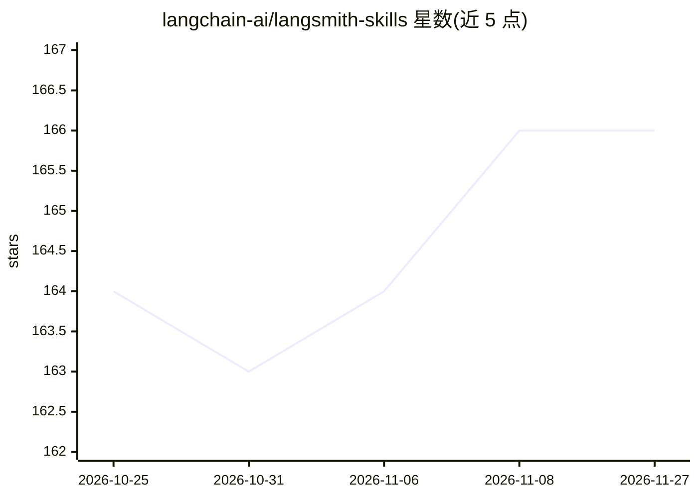

# langchain-ai/langsmith-skills

⭐ 166 · Python · MIT · 推送 2026-11-20 · [GitHub](https://github.com/langchain-ai/langsmith-skills) · 组织维护

**已弃置的 LangSmith agent 技能集，迁移指引指向 langchain-skills**

本仓库为 LangSmith 相关的编码 agent 技能集（trace、在线评估、数据集、评估器、实验诊断、Custom Apps 等），当前已弃置并将归档，不再接收更新，技能内容仅指向替代位置。README 主体为迁移指引：按 Claude Code 插件、npx skills、install.sh、Deep Agents Code 四种安装方式给出移除旧技能并安装 langchain-skills 插件的步骤，并以表格列出每个旧技能对应的新技能；完整历史版本保留在 git 历史中，PR 改为提交到新仓库。

## 筛选速览

| 维度 | 判定 | 备注 |
|---|---|---|
| AI 角色 | `ai-knowledge` | 知识聚合/清单类 |
| 许可风险 | `permissive` | MIT |
| 部署形态 | `library` | 以包/库形式分发 |
| 模型依赖 | — | README 未给出锁定关系 |
| 硬件要求 | — | 无带数字的原话,不猜 |
| 安装摩擦 | `low` | 无编译、无系统依赖或容器化 |
| 成熟度 | — | 结构信号不足 |

## 能力要点

- 提供四种安装途径（Claude Code 插件/npx skills/install.sh/Deep Agents Code）的迁移步骤
- 表格逐一映射旧技能到 langchain-skills 中的新技能
- 仓库弃置后不再接收更新，技能仅指向替代位置

## 适用场景

- 移除旧 langsmith-* 技能并迁移到 langchain-skills 插件
- 在 Claude Code/npx skills 中切换到 langchain-skills 插件
- 查找 langsmith-trace 等旧技能的新替代名称

## 场景标签

`编码 Agent` · 领域:编码与开发

## 证据(README 行号)

> L4: > **This repository is deprecated and will be archived.** The LangSmith skills
> L8: > repository no longer receives updates; its skills now only point to their
> L56: |Old skill|New skill|

## 星数曲线

2026-10-25 164 → 2026-11-27 166（+2）

---
*卡片 v1 · prompt 1.4 · 生成 2026-11-27 · 置信度 high · 依据 README sha `a2f145a9e059` · [字段定义](../../DATASET.md)*
