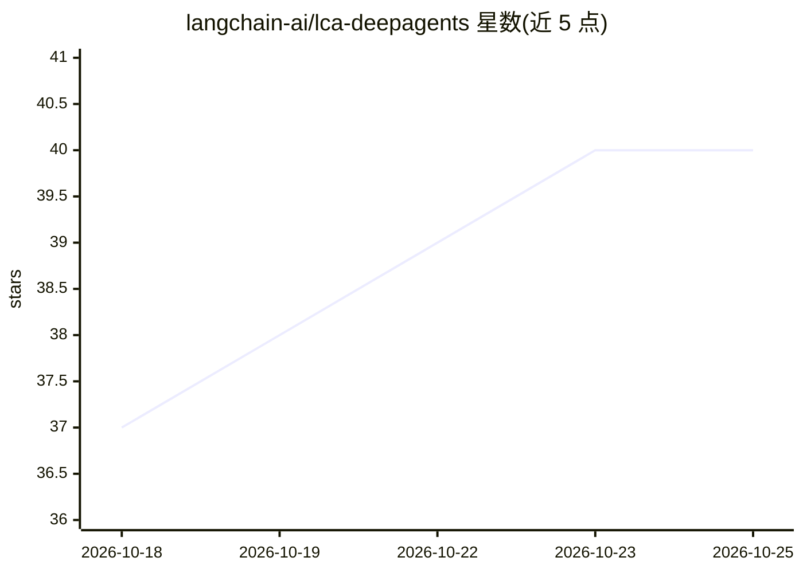

# langchain-ai/lca-deepagents

⭐ 40 · TypeScript · 推送 2026-10-24 · [GitHub](https://github.com/langchain-ai/lca-deepagents) · 组织维护

**LangChain Academy 深度 Agent 课程配套材料**

LangChain Academy 发布的 Deep Agents 课程配套材料仓库。README 仅说明其用途为课程材料，具体内容在 Contents 之后展开（窗口内未展示）。面向学习 LangChain 深度 Agent 构建的开发者，属于教程/知识类资源，而非可安装运行的产品。可见行数有限，多数事实无法核验，故字段从简。

## 筛选速览

| 维度 | 判定 | 备注 |
|---|---|---|
| AI 角色 | `ai-knowledge` | 知识聚合/清单类 |
| 许可风险 | `none` | — |
| 部署形态 | `None` |  |
| 模型依赖 | — | README 未给出锁定关系 |
| 硬件要求 | — | 无带数字的原话,不猜 |
| 安装摩擦 | `low` | 无编译、无系统依赖或容器化 |
| 成熟度 | — | 结构信号不足 |

## 能力要点

- LangChain Academy 官方 Deep Agents 课程材料

## 适用场景

- 跟随 LangChain Academy 课程学习深度 Agent 构建

## 场景标签

`教程课程` · 领域:学习与行业

## 证据(README 行号)

> L1: # Deep Agents
> L3: Course materials for the Deep Agents course on LangChain Academy.

## 星数曲线

2026-10-18 37 → 2026-10-25 40（+3）

---
*卡片 v1 · prompt 1.4 · 生成 2026-10-25 · 置信度 low · 依据 README sha `a4f4b30de3f3` · [字段定义](../../DATASET.md)*
