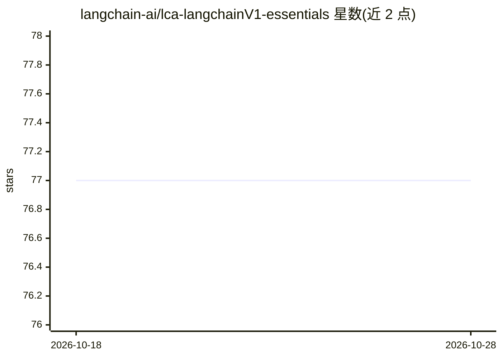

# langchain-ai/lca-langchainV1-essentials

⭐ 77 · Jupyter Notebook · MIT · 推送 2026-09-09 · [GitHub](https://github.com/langchain-ai/lca-langchainV1-essentials) · 组织维护

**LangChain v1 课程配套代码库，含本地 LLM 版本**

LangChain 官方课程（lca）LangChain v1 essentials 的配套练习仓库，含三个目录：./python、./python_local（为偏好使用本地存储 LLM 的学员准备）与 ./js，各目录有各自的 README 说明。顶层 README 仅提供目录导航信息，具体安装与运行方式需查看各子目录 README。可见内容未列明具体依赖或课程章节。

## 筛选速览

| 维度 | 判定 | 备注 |
|---|---|---|
| AI 角色 | `ai-knowledge` | 知识聚合/清单类 |
| 许可风险 | `permissive` | MIT |
| 部署形态 | `None` |  |
| 模型依赖 | — | README 未给出锁定关系 |
| 硬件要求 | — | 无带数字的原话,不猜 |
| 安装摩擦 | `low` | 无编译、无系统依赖或容器化 |
| 成熟度 | — | 结构信号不足 |

## 能力要点

- 提供 Python、JavaScript 两套课程代码目录
- 含 python_local 目录供学员使用本地存储的 LLM
- 各子目录有独立 README

## 适用场景

- 跟随 LangChain v1 课程做配套练习
- 在本地 LLM 环境下学习 LangChain 用法

## 场景标签

`教程课程` · 领域:学习与行业

## 证据(README 行号)

> L3: **NOTE:** We have added the ./python_local directory for students who would prefer using locally stored LLMs.
> L5: See the ./python, ./python_local or ./js directorys for their respective READMEs

## 星数曲线

2026-10-18 77 → 2026-10-28 77（+0）

---
*卡片 v1 · prompt 1.4 · 生成 2026-10-24 · 置信度 low · 依据 README sha `305580af034c` · [字段定义](../../DATASET.md)*
