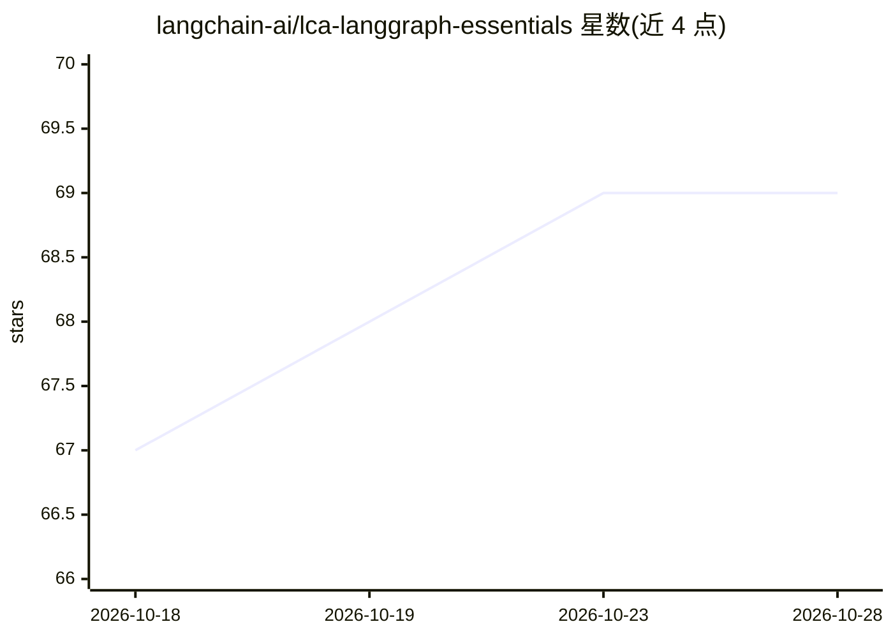

# langchain-ai/lca-langgraph-essentials

⭐ 69 · Jupyter Notebook · MIT · 推送 2026-07-21 · [GitHub](https://github.com/langchain-ai/lca-langgraph-essentials) · 组织维护

**LangGraph 教学课程仓库（仅标题可辨）**

README 仅含一行标题 "lca-langgraphV1-essentials"，无其他可验证内容。从仓库名称与所属组织 langchain-ai 可见，该仓库与 LangGraph 相关，lca 前缀通常对应 LangChain Academy 教学材料命名，但仓库内未展示任何课程大纲、安装说明或代码结构说明，无法进一步核实其功能与内容。

## 筛选速览

| 维度 | 判定 | 备注 |
|---|---|---|
| AI 角色 | `ai-ecosystem` | LLM/agent 周边工具 |
| 许可风险 | `permissive` | MIT |
| 部署形态 | `None` |  |
| 模型依赖 | — | README 未给出锁定关系 |
| 硬件要求 | — | 无带数字的原话,不猜 |
| 安装摩擦 | `low` | 无编译、无系统依赖或容器化 |
| 成熟度 | — | 结构信号不足 |

## 能力要点

- README 仅一行标题，无功能描述
- 隶属 langchain-ai 组织，名称指向 LangGraph 相关内容

## 适用场景

- 无法从 README 确认，暂不列出

## 场景标签

`教程课程` · 领域:学习与行业

## 证据(README 行号)

> L1: # lca-langgraphV1-essentials

## 星数曲线

2026-10-18 67 → 2026-10-28 69（+2）

---
*卡片 v1 · prompt 1.4 · 生成 2026-10-24 · 置信度 low · 依据 README sha `14d38e78dc9a` · [字段定义](../../DATASET.md)*
