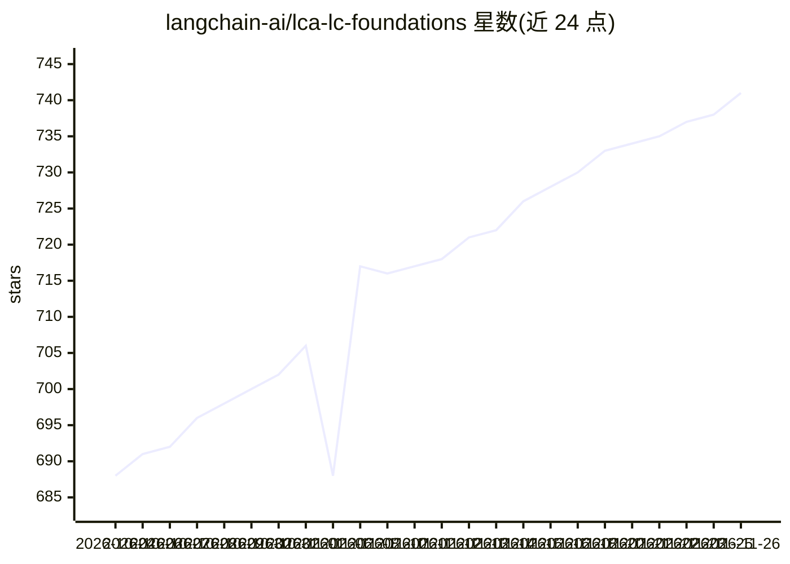

# langchain-ai/lca-lc-foundations

⭐ 741 · TypeScript · MIT · 推送 2026-11-24 · [GitHub](https://github.com/langchain-ai/lca-lc-foundations) · 组织维护

**面向开发者的 LangChain 入门课程配套 Notebook 仓库**

LangChain Academy 官方课程的配套代码仓库，含三个模块的 Jupyter Notebook：创建 Agent（工具、短期记忆、多模态消息）、进阶 Agent（MCP、上下文与状态、多 Agent 系统）、生产级 Agent（中间件、长对话管理、人在回路）。提供 uv/pip 两种环境安装路径、env_utils.py 环境校验脚本、LangSmith LLM Gateway 或直连两种模型接入配置，以及可选的 langgraph dev 运行 Studio。

## 筛选速览

| 维度 | 判定 | 备注 |
|---|---|---|
| AI 角色 | `ai-knowledge` | 知识聚合/清单类 |
| 许可风险 | `permissive` | MIT |
| 部署形态 | `library` | 以包/库形式分发 |
| 模型依赖 | — | README 未给出锁定关系 |
| 硬件要求 | — | 无带数字的原话,不猜 |
| 安装摩擦 | `low` | 无编译、无系统依赖或容器化 |
| 成熟度 | — | 结构信号不足 |

## 能力要点

- 三个模块递进式课程：创建 Agent、进阶 Agent（含 MCP 与多 Agent）、生产级 Agent（含中间件与 HITL）
- 支持 LangSmith LLM Gateway 接入，无需本地 provider 密钥
- 提供 env_utils.py 环境验证脚本排查配置问题
- 每个模块附带实践项目（Personal Chef / Wedding Planner / Email Assistant）

## 适用场景

- 跟着课程从零学习 LangChain 的 Agent 开发功能
- 在本地 Notebook 环境中运行课程示例与练习
- 配置 LangSmith Gateway 或直连密钥来调用课程中的聊天模型

## 场景标签

`教程课程` · 领域:学习与行业

## 证据(README 行号)

> L5: Welcome to LangChain Academy's **Introduction to LangChain** course!
> L140: This repository contains three Modules that serve as introductions to many of LangChain's most-used features.
> L152: - Model Context Protocol (MCP)

## 星数曲线

2026-10-24 688 → 2026-11-26 741（+53）

---
*卡片 v1 · prompt 1.4 · 生成 2026-11-26 · 置信度 high · 依据 README sha `8717edaf4639` · [字段定义](../../DATASET.md)*
