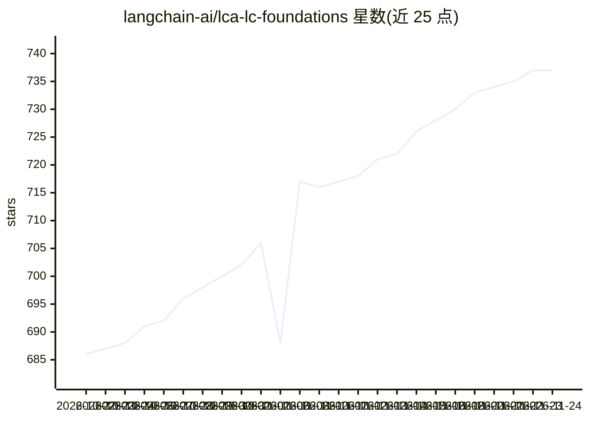

# langchain-ai/lca-lc-foundations

⭐ 737 · TypeScript · MIT · 推送 2026-11-22 · [GitHub](https://github.com/langchain-ai/lca-lc-foundations) · 组织维护

**LangChain Academy 官方入门课程配套 notebook 库**

LangChain Academy《Introduction to LangChain》课程的配套代码仓库，包含三个模块共多个 Jupyter notebook 课程：创建 Agent（模型、工具、短期记忆、多模态消息）、高级 Agent（MCP、状态管理、多 Agent 系统）、生产级 Agent（中间件、长对话管理、人工介入）。README 提供完整的环境搭建流程：git clone 源码、配置 .env 中的模型 API key、用 uv 或 pip 建虚拟环境安装依赖，并附环境验证脚本与常见配置问题的排查说明。可选集成 LangSmith 做评测与追踪。

## 筛选速览

| 维度 | 判定 | 备注 |
|---|---|---|
| AI 角色 | `ai-knowledge` | 知识聚合/清单类 |
| 许可风险 | `permissive` | MIT |
| 部署形态 | `library` | 以包/库形式分发 |
| 模型依赖 | — | README 未给出锁定关系 |
| 硬件要求 | — | 无带数字的原话,不猜 |
| 安装摩擦 | `low` | 无编译、无系统依赖或容器化 |
| 成熟度 | — | 结构信号不足 |

## 能力要点

- 三个模块课程：创建 Agent、高级 Agent、生产级 Agent
- 提供 uv 与 pip 两种依赖安装路径及环境验证脚本
- 可选启用 LangSmith 追踪与评测
- 涵盖 MCP、多 Agent、Human-in-the-loop 等主题

## 适用场景

- 跟学 LangChain 官方入门课程并运行配套 notebook
- 学习如何用 create_agent 构建工具调用 Agent
- 练习 MCP、多 Agent 系统与生产化部署流程

## 场景标签

`教程课程` · 领域:学习与行业

## 证据(README 行号)

> L5: Welcome to LangChain Academy's **Introduction to LangChain** course!
> L115: This repository contains three Modules that serve as introductions to many of LangChain's most-used features.

## 星数曲线

2026-10-22 686 → 2026-11-24 737（+51）

---
*卡片 v1 · prompt 1.4 · 生成 2026-11-24 · 置信度 high · 依据 README sha `a3c60de27bcd` · [字段定义](../../DATASET.md)*
