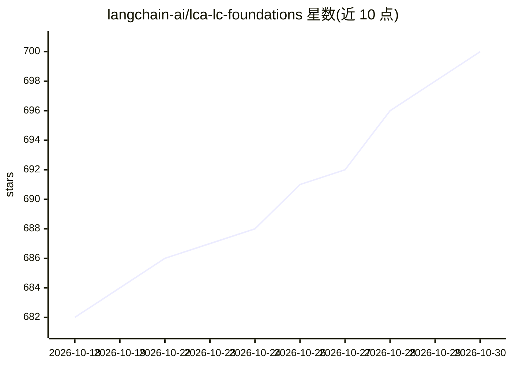

# langchain-ai/lca-lc-foundations

⭐ 700 · TypeScript · MIT · 推送 2026-10-28 · [GitHub](https://github.com/langchain-ai/lca-lc-foundations) · 组织维护

**LangChain 入门课程的配套代码仓库（三模块）**

LangChain Academy《Introduction to LangChain》课程的配套代码库：以 Jupyter notebook 形式提供三个教学模块——创建 Agent（模型/工具/短期记忆/多模态）、进阶 Agent（MCP/上下文与状态/多 Agent 系统）、面向生产的 Agent（中间件/长对话管理/HITL/动态 Agent），每个模块含实战项目。安装方式为 git clone 后用 uv 或 pip 建虚拟环境装依赖，需配置 OpenAI API key（课程主要用 gpt-5-nano），可选 Anthropic、Google 与 LangSmith。限制：要求 Python >=3.12, <3.14，需自行准备模型 API key。

## 筛选速览

| 维度 | 判定 | 备注 |
|---|---|---|
| AI 角色 | `ai-knowledge` | 知识聚合/清单类 |
| 许可风险 | `permissive` | MIT |
| 部署形态 | `library` | 以包/库形式分发 |
| 模型依赖 | — | README 未给出锁定关系 |
| 硬件要求 | — | 无带数字的原话,不猜 |
| 安装摩擦 | `low` | 无编译、无系统依赖或容器化 |
| 成熟度 | — | 结构信号不足 |

## 能力要点

- 三个教学模块：创建 Agent / 进阶 Agent / 生产就绪 Agent
- 含 MCP、多 Agent 系统、HITL 等课程内容与实战项目
- 提供 uv 与 pip 两种环境搭建方式及 env_utils.py 环境校验脚本
- 可选用 langgraph dev 运行 Studio（可选功能）

## 适用场景

- 跟随 LangChain Academy 课程动手学习 LangChain
- 学习构建带工具调用与记忆的 Agent
- 了解 MCP 与多 Agent 系统的课程示例

## 场景标签

`教程课程` · 领域:学习与行业

## 证据(README 行号)

> L5: Welcome to LangChain Academy's **Introduction to LangChain** course!
> L7: This repository is the companion to the course located HERE.
> L115: This repository contains three Modules that serve as introductions to many of LangChain's most-used features.

## 星数曲线

2026-10-18 682 → 2026-10-30 700（+18）

---
*卡片 v1 · prompt 1.4 · 生成 2026-10-21 · 置信度 high · 依据 README sha `43b87af13bc2` · [字段定义](../../DATASET.md)*
