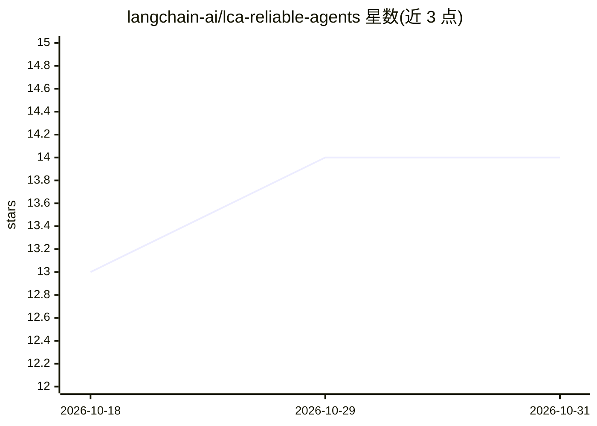

# langchain-ai/lca-reliable-agents

⭐ 14 · Python · MIT · 推送 2026-07-15 · [GitHub](https://github.com/langchain-ai/lca-reliable-agents) · 组织维护

**LangSmith Professional 课程材料：代理的 Python/TypeScript 实现**

LangChain 官方组织发布的 LangSmith Professional 课程配套代码仓库，提供 Python 与 TypeScript 两套镜像实现。内容包括 OfficeFlow 客服代理（Emma）的多版本实现，从无 tracing 的基线 agent 逐步演进，覆盖课程的实验与可观测性主题。供课程学员与使用 LangSmith 的开发者参考运行，无安装说明以外的独立产品形态。

## 筛选速览

| 维度 | 判定 | 备注 |
|---|---|---|
| AI 角色 | `ai-knowledge` | 知识聚合/清单类 |
| 许可风险 | `permissive` | MIT |
| 部署形态 | `None` |  |
| 模型依赖 | — | README 未给出锁定关系 |
| 硬件要求 | — | 无带数字的原话,不猜 |
| 安装摩擦 | `low` | 无编译、无系统依赖或容器化 |
| 成熟度 | — | 结构信号不足 |

## 能力要点

- Python 与 TypeScript 目录互为镜像的等价实现
- OfficeFlow 客服代理（Emma）多版本演进示例
- 包含无 tracing 的基线 agent 版本用于对照

## 适用场景

- 跟随 LangSmith Professional 课程动手实践
- 参考客服代理的迭代实现方式
- 对照 Python/TypeScript 两种语言的实现差异

## 场景标签

`教程课程` · 领域:学习与行业

## 证据(README 行号)

> L1: # LCA LangSmith Professional
> L3: Course materials for LangSmith Professional, with Python and TypeScript implementations.

## 星数曲线

2026-10-18 13 → 2026-10-31 14（+1）

---
*卡片 v1 · prompt 1.4 · 生成 2026-10-31 · 置信度 mid · 依据 README sha `de0e44d5c52e` · [字段定义](../../DATASET.md)*
