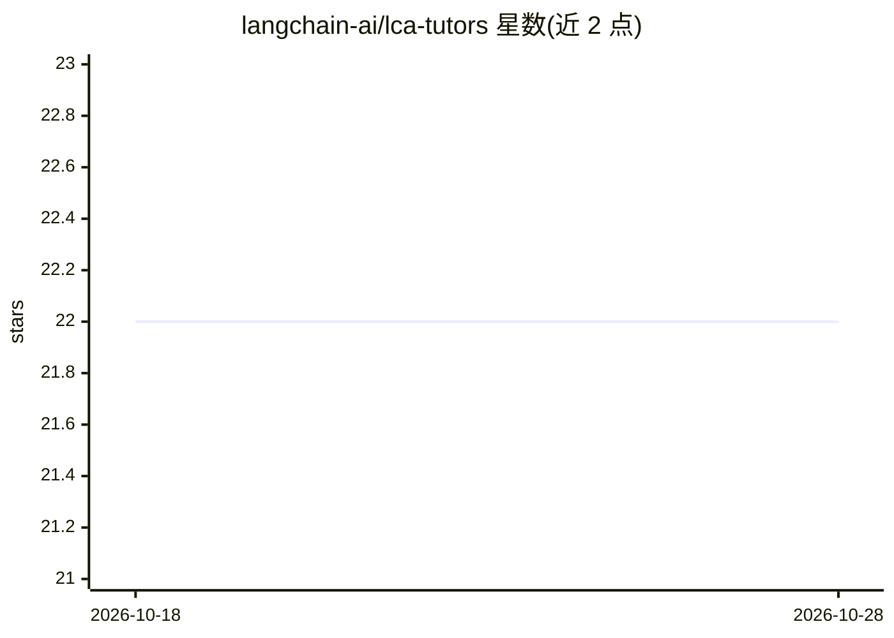

# langchain-ai/lca-tutors

⭐ 22 · 推送 2026-08-07 · [GitHub](https://github.com/langchain-ai/lca-tutors) · 组织维护

**LangChain Academy 课程的 Claude Code 辅导技能合集**

langchain-ai 维护的仓库，为 LangChain Academy 课程提供基于技能（skill）的 AI 辅导：每门课程一个独立子目录，做成自包含的 Claude Code skill。当前收录 Deep Agents 课程的辅导技能。安装方式为通过 Node.js 运行 npx skills add 命令将指定课程技能添加到 Claude Code 环境。面向 LangChain Academy 课程的学习者。

## 筛选速览

| 维度 | 判定 | 备注 |
|---|---|---|
| AI 角色 | `ai-knowledge` | 知识聚合/清单类 |
| 许可风险 | `none` | — |
| 部署形态 | `library` | 以包/库形式分发 |
| 模型依赖 | — | README 未给出锁定关系 |
| 硬件要求 | — | 无带数字的原话,不猜 |
| 安装摩擦 | `low` | 无编译、无系统依赖或容器化 |
| 成熟度 | — | 结构信号不足 |

## 能力要点

- 每门课程一个自包含的 Claude Code skill 子目录
- npx skills add 一条命令安装指定课程技能
- 由 langchain-ai 组织维护

## 适用场景

- 学习 LangChain Academy 课程时获得 AI 辅导
- 在 Claude Code 中按课程安装辅导技能

## 场景标签

`教程课程` · 领域:学习与行业

## 证据(README 行号)

> L3: Skill-based tutors for LangChain Academy courses. Each course lives in its own
> L4: subdirectory as a self-contained Claude Code skill.

## 星数曲线

2026-10-18 22 → 2026-10-28 22（+0）

---
*卡片 v1 · prompt 1.4 · 生成 2026-10-27 · 置信度 mid · 依据 README sha `4787a2cd06e2` · [字段定义](../../DATASET.md)*
