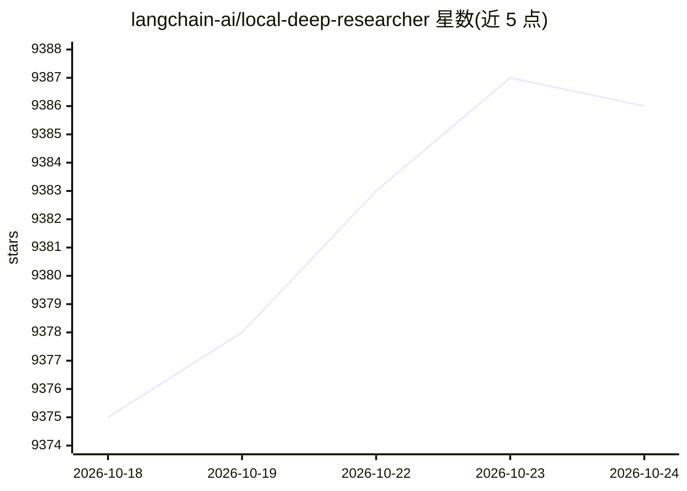

# langchain-ai/local-deep-researcher

⭐ 9,388 · Python · MIT · 推送 2026-10-15 · [GitHub](https://github.com/langchain-ai/local-deep-researcher) · 组织维护

**全本地化网络深度研究助手：给定主题自动多轮搜索并生成报告**

基于 LangGraph 构建的本地网络研究助手：给定研究主题后，调用 Ollama 或 LMStudio 托管的本地 LLM 生成搜索查询，抓取并总结网页搜索结果，反思总结以发现知识缺口，生成新查询再循环（循环次数可配置），最终输出带来源引用的 Markdown 研究报告。搜索默认用 DuckDuckGo（无需 API key），可选 SearXNG、Tavily 或 Perplexity。通过 LangGraph Studio UI 交互，需从源码克隆并以 uv/pip 启动 LangGraph 服务，Docker 镜像不内置 Ollama 需另行运行。部分模型（如 DeepSeek R1 小尺寸版）难以产出结构化 JSON 时有回退机制。

## 筛选速览

| 维度 | 判定 | 备注 |
|---|---|---|
| AI 角色 | `ai-native` | 本体是模型或模型工具 |
| 许可风险 | `permissive` | MIT |
| 部署形态 | `self-host` | docker 或自建部署 |
| 模型依赖 | local-ok | 支持本地模型 |
| 硬件要求 | — | 无带数字的原话,不猜 |
| 安装摩擦 | `low` | 无编译、无系统依赖或容器化 |
| 成熟度 | — | 结构信号不足 |

## 能力要点

- 搜索-总结-反思-再搜索的迭代研究循环，循环次数可配置
- 支持 Ollama 与 LMStudio 托管的任意本地 LLM
- 默认 DuckDuckGo 搜索无需 API key，可选 Tavily/Perplexity/SearXNG
- 输出带来源引用的 Markdown 报告，可在 LangGraph Studio 中可视化过程

## 适用场景

- 在本地跑深度研究：给一个主题自动多轮检索并汇总成报告
- 不依赖云端 LLM 服务完成文献式调研
- 在 LangGraph Studio 中观察研究 Agent 的中间状态与来源

## 场景标签

`科研工具` · 领域:学习与行业

## 证据(README 行号)

> L3: Local Deep Researcher is a fully local web research assistant that uses any LLM hosted by Ollama or LMStudio. Give i
> L160: - Given a user-provided topic, use a local LLM (via Ollama or LMStudio) to generate a web search query

## 星数曲线

2026-10-18 9,375 → 2026-10-24 9,386（+11）

---
*卡片 v1 · prompt 1.4 · 生成 2026-10-20 · 置信度 high · 依据 README sha `6296852502fb` · [字段定义](../../DATASET.md)*
