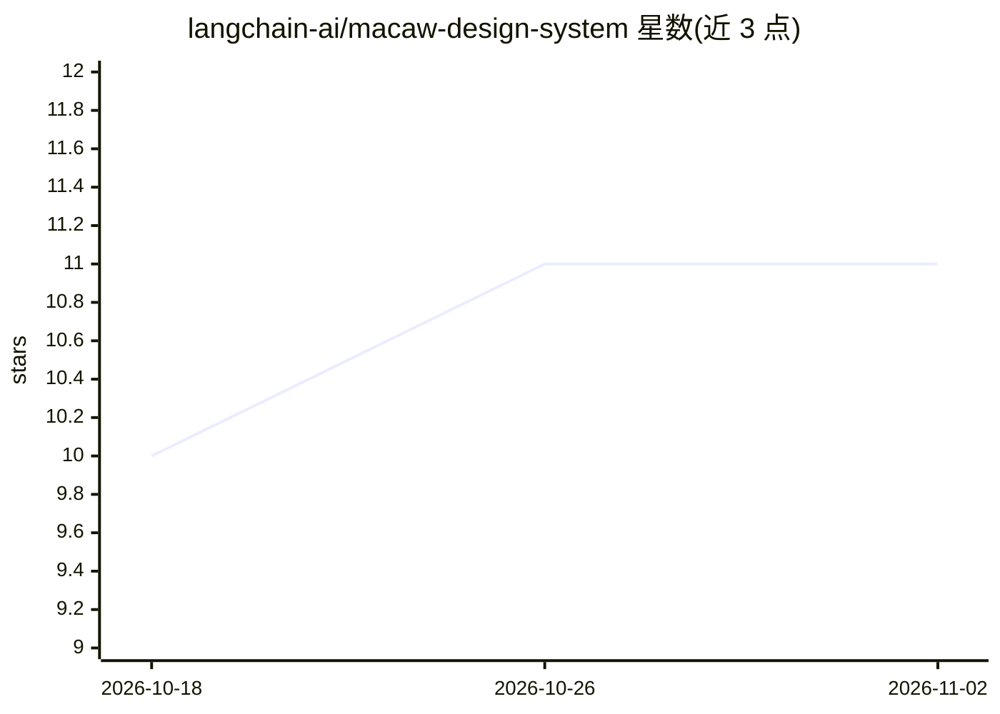

# langchain-ai/macaw-design-system

⭐ 11 · TypeScript · MIT · 推送 2026-10-31 · [GitHub](https://github.com/langchain-ai/macaw-design-system) · 组织维护

**LangChain 产品套件共享的 React 设计系统与组件库**

LangChain 官方维护的共享 UI 与设计基础库，以三个 npm 包发布：macaw-components（React 组件、样式、图标）、macaw-tokens（框架无关的主题令牌）、macaw-cli（组件发现与 agent 脚手架）。面向开发 LangChain 系产品界面的团队，要求 React 19 与 Node 26 或更新版本；提供暗色主题、Tailwind v4 可选映射，CLI 可 init/search/inspect 组件目录并生成面向编码 agent 的技能文档。MIT 许可。

## 筛选速览

| 维度 | 判定 | 备注 |
|---|---|---|
| AI 角色 | `ai-ecosystem` | LLM/agent 周边工具 |
| 许可风险 | `permissive` | MIT |
| 部署形态 | `library` | 以包/库形式分发 |
| 模型依赖 | — | README 未给出锁定关系 |
| 硬件要求 | — | 无带数字的原话,不猜 |
| 安装摩擦 | `low` | 无编译、无系统依赖或容器化 |
| 成熟度 | — | 结构信号不足 |

## 能力要点

- 三个协同发版的包：组件库、主题令牌、CLI
- macaw CLI 支持组件搜索、检查与 agent 技能脚手架
- 提供暗色主题与可选 Tailwind v4 预设映射

## 适用场景

- 为基于 LangChain 的产品构建统一风格的界面
- 在设计工具中引用框架无关的主题令牌
- 让编码 agent 通过 CLI 与技能文档使用组件

## 场景标签

 · 领域:前端/设计系统

## 证据(README 行号)

> L7:  The shared UI & Design foundation for the LangChain product suite.
> L19: Welcome to Macaw, LangChain’s design system! The name is a nod to our original 🦜🔗 logo. The macaw’s varied colors r
> L37: |`@langchain/macaw-cli`|Component discovery and agent scaffolding|

## 星数曲线

2026-10-18 10 → 2026-11-02 11（+1）

---
*卡片 v1 · prompt 1.4 · 生成 2026-11-02 · 置信度 mid · 依据 README sha `5801a50f8331` · [字段定义](../../DATASET.md)*
