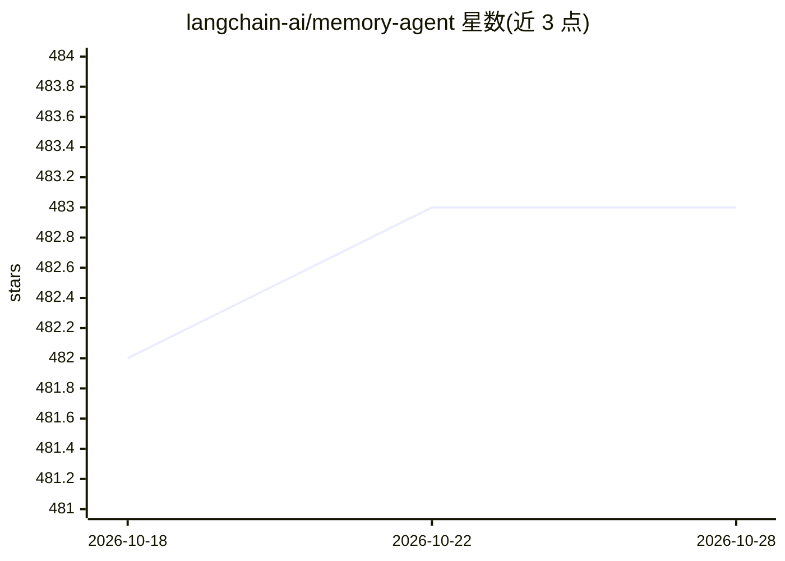

# langchain-ai/memory-agent

⭐ 483 · Python · MIT · 推送 2026-10-25 · [GitHub](https://github.com/langchain-ai/memory-agent) · 组织维护

**LangGraph ReAct 记忆代理示例：带记忆保存工具的对话 agent**

langchain-ai 官方提供的 ReAct 风格 agent 示例工程：agent 通过 store_memory 工具将重要信息按可配置 user_id 持久化到 LangGraph Store，从而在跨会话线程间复用用户偏好；读取时列出已抽取的记忆。部署路径为 LangGraph Cloud/LangGraph Studio，默认模型 anthropic/claude-3-5-sonnet-20240620，可通过 provider/model-name 配置换用 OpenAI 等兼容模型。附记忆结构自定义、追加工具、改提示词等扩展说明，并用 LangSmith @unit 跑评测用例。

## 筛选速览

| 维度 | 判定 | 备注 |
|---|---|---|
| AI 角色 | `ai-native` | 本体是模型或模型工具 |
| 许可风险 | `permissive` | MIT |
| 部署形态 | `None` |  |
| 模型依赖 | locked-api |  |
| 硬件要求 | — | 无带数字的原话,不猜 |
| 安装摩擦 | `low` | 无编译、无系统依赖或容器化 |
| 成熟度 | — | 结构信号不足 |

## 能力要点

- ReAct agent 带 store_memory 工具，记忆按 user_id 持久化
- 跨线程复用已保存记忆，Studio 内可查看记忆
- 模型可经 provider/model-name 配置换用
- 提供基于 LangSmith @unit 的记忆评测用例

## 适用场景

- 学习/参考如何为 agent 实现跨会话记忆
- 以该模板为基础定制自己的记忆型对话服务
- 在 LangGraph Cloud 上部署可从任意 API 访问的记忆服务

## 场景标签

`Agent 记忆` · 领域:Agent 开发

## 证据(README 行号)

> L6: This repo provides a simple example of a ReAct-style agent with a tool to save memories. This is a simple way to let
> L66: This chat bot reads from your memory graph's `Store` to easily list extracted memories. If it calls a tool, LangGra

## 星数曲线

2026-10-18 482 → 2026-10-28 483（+1）

---
*卡片 v1 · prompt 1.4 · 生成 2026-10-21 · 置信度 high · 依据 README sha `c29b96fbaf0d` · [字段定义](../../DATASET.md)*
