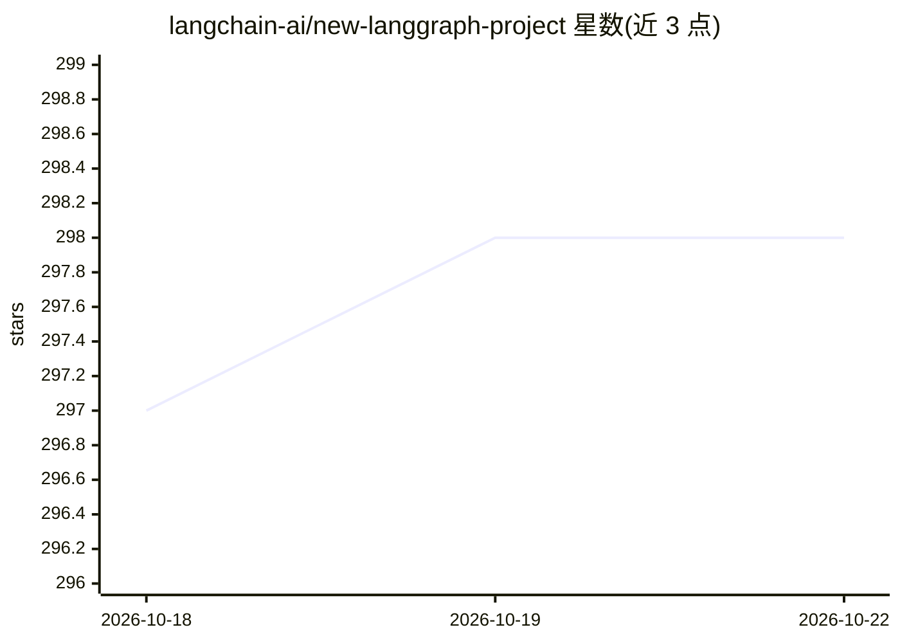

# langchain-ai/new-langgraph-project

⭐ 298 · Python · MIT · 推送 2026-10-19 · [GitHub](https://github.com/langchain-ai/new-langgraph-project) · 组织维护

**LangGraph 官方项目模板：演示如何用 LangGraph Server/Studio 起步**

基于 LangGraph 的应用起始模板：核心逻辑在 src/agent/graph.py，演示单步返回固定字符串的应用，可扩展为更复杂的 agent 工作流；面向想上手 LangGraph Server 与 LangGraph Studio（可视化调试 IDE）的开发者。通过 pip 安装依赖与 langgraph-cli，用 langgraph dev 启动本地服务器；支持 LangSmith 追踪集成与热重载调试。模板本身不含具体模型调用逻辑。

## 筛选速览

| 维度 | 判定 | 备注 |
|---|---|---|
| AI 角色 | `ai-ecosystem` | LLM/agent 周边工具 |
| 许可风险 | `permissive` | MIT |
| 部署形态 | `library` | 以包/库形式分发 |
| 模型依赖 | — | README 未给出锁定关系 |
| 硬件要求 | — | 无带数字的原话,不猜 |
| 安装摩擦 | `low` | 无编译、无系统依赖或容器化 |
| 成熟度 | — | 结构信号不足 |

## 能力要点

- 单步示例图（src/agent/graph.py），可扩展节点与边
- langgraph dev 一键启动 LangGraph Server
- LangGraph Studio 可视化调试：编辑历史状态、从既往状态重跑、热重载
- 支持 LangSmith API key 集成追踪

## 适用场景

- 以模板快速搭建基于 LangGraph 的 agent 应用
- 在 LangGraph Studio 中可视化调试与迭代图结构
- 接入 LangSmith 做对话应用的追踪分析

## 场景标签

`Agent 框架` · 领域:Agent 开发

## 证据(README 行号)

> L6: This template demonstrates a simple application implemented using LangGraph, designed for showing how to get started
> L20: pip install -e . "langgraph-cli[inmem]"

## 星数曲线

2026-10-18 297 → 2026-10-22 298（+1）

---
*卡片 v1 · prompt 1.4 · 生成 2026-10-21 · 置信度 high · 依据 README sha `68d3ce62c7bb` · [字段定义](../../DATASET.md)*
