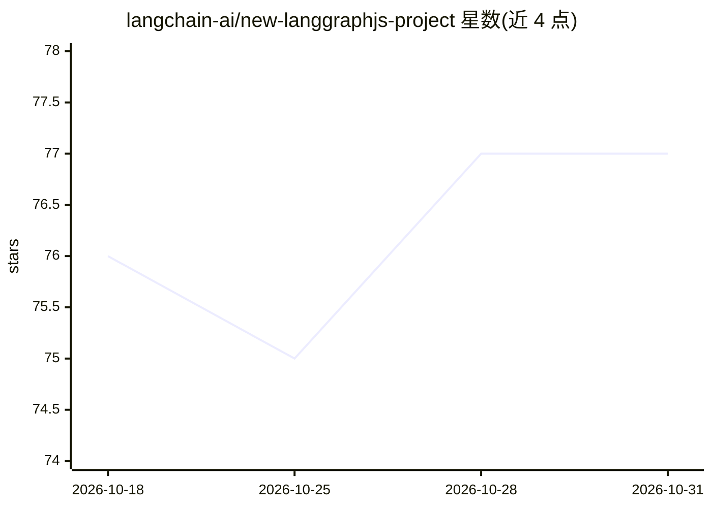

# langchain-ai/new-langgraphjs-project

⭐ 77 · TypeScript · MIT · 推送 2026-10-19 · [GitHub](https://github.com/langchain-ai/new-langgraphjs-project) · 组织维护

**LangGraph.js 聊天机器人项目模板，供快速起步开发**

LangGraph.js 的空项目模板：核心逻辑在 src/agent/graph.ts 中实现一个简单聊天机器人，接收用户消息、维护会话历史并返回占位回复（不含 LLM 调用）。模板演示 LangGraph Server 的启动方式与 LangGraph Studio 可视化调试 IDE 的使用，支持热重载、编辑历史状态重放调试。用户通过 npx @langchain/langgraph-cli 安装并启动，用 yarn 安装依赖，可自行替换模型、扩展图节点或添加 RAG 等能力。

## 筛选速览

| 维度 | 判定 | 备注 |
|---|---|---|
| AI 角色 | `ai-ecosystem` | LLM/agent 周边工具 |
| 许可风险 | `permissive` | MIT |
| 部署形态 | `library` | 以包/库形式分发 |
| 模型依赖 | — | README 未给出锁定关系 |
| 硬件要求 | — | 无带数字的原话,不猜 |
| 安装摩擦 | `low` | 无编译、无系统依赖或容器化 |
| 成熟度 | — | 结构信号不足 |

## 能力要点

- 演示 LangGraph Server 与 LangGraph Studio 可视化调试的起步模板
- 图逻辑集中在 src/agent/graph.ts，可自定义节点与流程
- 支持热重载与从历史状态重放调试
- 可接入 LangChain.js 聊天模型包装器或添加 RAG 能力

## 适用场景

- 作为 LangGraph.js 项目的初始脚手架快速开始开发
- 在 LangGraph Studio 中调试和迭代 agent 图
- 学习 LangGraph Server 的本地开发流程

## 场景标签

`Agent 框架` · 领域:Agent 开发

## 证据(README 行号)

> L6: This template demonstrates a simple chatbot implemented using LangGraph.js, showing how to get started with LangGrap
> L59: 1. **Add an LLM call**: You can select and install a chat model wrapper from the LangChain.js ecosystem, or use Lan

## 星数曲线

2026-10-18 76 → 2026-10-31 77（+1）

---
*卡片 v1 · prompt 1.4 · 生成 2026-10-24 · 置信度 high · 依据 README sha `d736ade52fda` · [字段定义](../../DATASET.md)*
