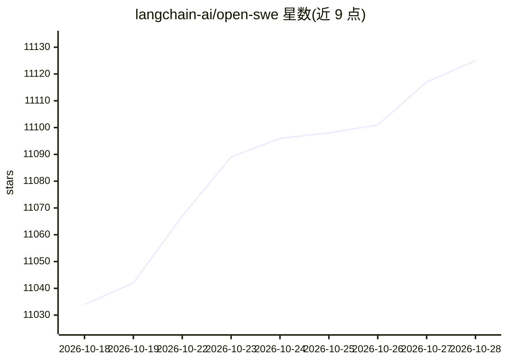

# langchain-ai/open-swe

⭐ 11,135 · Python · MIT · 推送 2026-10-28 · [GitHub](https://github.com/langchain-ai/open-swe) · [官网](https://www.langchain.com/blog/open-swe-an-open-source-framework-for-internal-coding-agents) · 组织维护

**开源异步编码代理：从代码调查到交付 PR 的软件工程系统**

由 LangChain 基于 Deep Agents 与 LangGraph 构建的开源软件工厂：调查代码库、在隔离沙箱中实现变更、执行验证并交付 pull request；同时支持 PR 审查（可学习仓库特定审查偏好）、CI 监控、定时任务与 Slack/Linear/GitHub 触发。执行依赖 Managed Deep Agents 私有 beta，否则需 fork 改造自有运行时；项目处活跃开发期，不接受外部贡献。沙箱运行于持久化 Linux 环境，LangSmith 为默认沙箱与追踪提供方。

## 筛选速览

| 维度 | 判定 | 备注 |
|---|---|---|
| AI 角色 | `ai-native` | 本体是模型或模型工具 |
| 许可风险 | `permissive` | MIT |
| 部署形态 | `None` |  |
| 模型依赖 | — | README 未给出锁定关系 |
| 硬件要求 | — | 无带数字的原话,不猜 |
| 安装摩擦 | `low` | 无编译、无系统依赖或容器化 |
| 成熟度 | `idea` | |

## 能力要点

- 从 issue/PR/定时任务触发：计划→沙箱实现→验证→交付 PR 的闭环
- 子代理并行研究与独立工作
- 按需/自动 PR 审查并从历史反馈学习审查偏好
- GitHub、Slack、Linear 多入口触发与人工审批机制

## 适用场景

- 让代理自动调查代码库并提交带验证的 pull request
- 在团队仓库上运行 PR 自动审查并积累审查偏好
- 定时巡检 opted-in PR 的 CI 并处理 flaky 任务

## 场景标签

`编码 Agent` `代码审查` · 领域:编码与开发

## 证据(README 行号)

> L15: Open SWE turns engineering work into a repeatable system: investigate a codebase, implement changes, validate them,
> L33: - **Build:** Investigate repositories, edit code, run focused validation, and open or update pull requests.
> L44: Deep Agents supplies planning, filesystem, shell, skills, and subagent primitives. LangGraph provides durable execu

## 星数曲线

2026-10-18 11,034 → 2026-10-28 11,125（+91）

---
*卡片 v1 · prompt 1.4 · 生成 2026-10-20 · 置信度 high · 依据 README sha `65f5ff79c402` · [字段定义](../../DATASET.md)*
