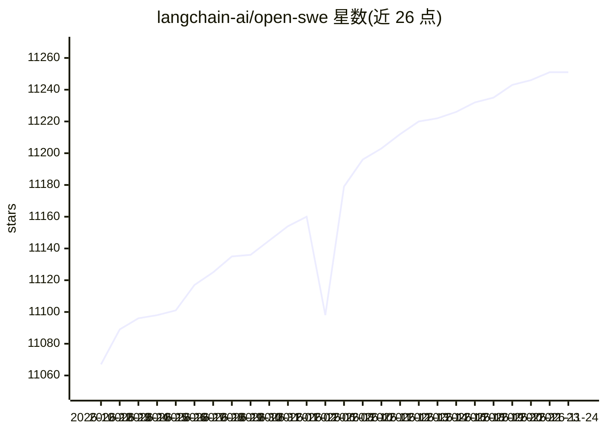

# langchain-ai/open-swe

⭐ 11,251 · Python · MIT · 推送 2026-11-22 · [GitHub](https://github.com/langchain-ai/open-swe) · [官网](https://www.langchain.com/blog/open-swe-an-open-source-framework-for-internal-coding-agents) · 组织维护

**给工程团队的开源异步编码 Agent：从 issue 到 PR**

Robin 是 LangChain 基于 Deep Agents 与 LangGraph 构建的开源异步编码 Agent：读取 issue、对话与 PR 输入，在隔离的 Linux 沙箱中调查代码库、实施修改、运行验证并交付 pull request；同时支持 PR 审查、学习仓库级审查偏好、监控 CI 并响应反馈。面向需要在自有基础设施中部署编码 Agent 的工程团队。可从 dashboard、GitHub、Slack、Linear 触发任务，支持模型、沙箱与集成自定义。注意：项目处于活跃开发期，不接受 issue 与外部贡献；按原样部署依赖 Managed Deep Agents，否则建议 fork 适配自身运行时。

## 筛选速览

| 维度 | 判定 | 备注 |
|---|---|---|
| AI 角色 | `ai-native` | 本体是模型或模型工具 |
| 许可风险 | `permissive` | MIT |
| 部署形态 | `None` |  |
| 模型依赖 | — | README 未给出锁定关系 |
| 硬件要求 | — | 无带数字的原话,不猜 |
| 安装摩擦 | `low` | 无编译、无系统依赖或容器化 |
| 成熟度 | `idea` | |

## 能力要点

- 在持久化 Linux 沙箱中实现 investigate→implement→validate→PR 流程
- 支持按需或自动 PR 审查、CI 监控与 /baby-sit 定时任务
- 由 Deep Agents 提供规划/文件系统/shell/子代理原语，LangGraph 提供持久执行
- 可自定义模型、推理力度、指令、技能、集成与沙箱提供方

## 适用场景

- 把 GitHub issue 自动转化为经过验证的 pull request
- 对 PR 做自动或人工触发的代码审查并发布结论
- 监控已接入 PR 的 CI，诊断失败并重跑不稳定任务
- 从 Slack 或 Linear 委派工程任务给 Agent 会话

## 场景标签

`编码 Agent` `代码审查` · 领域:编码与开发

## 证据(README 行号)

> L11: Robin turns engineering work into a repeatable system: investigate a codebase, implement changes, validate them, an
> L48: Deep Agents supplies planning, filesystem, shell, skills, and subagent primitives.

## 星数曲线

2026-10-22 11,067 → 2026-11-24 11,251（+184）

---
*卡片 v1 · prompt 1.4 · 生成 2026-11-22 · 置信度 high · 依据 README sha `4a547619447c` · [字段定义](../../DATASET.md)*
