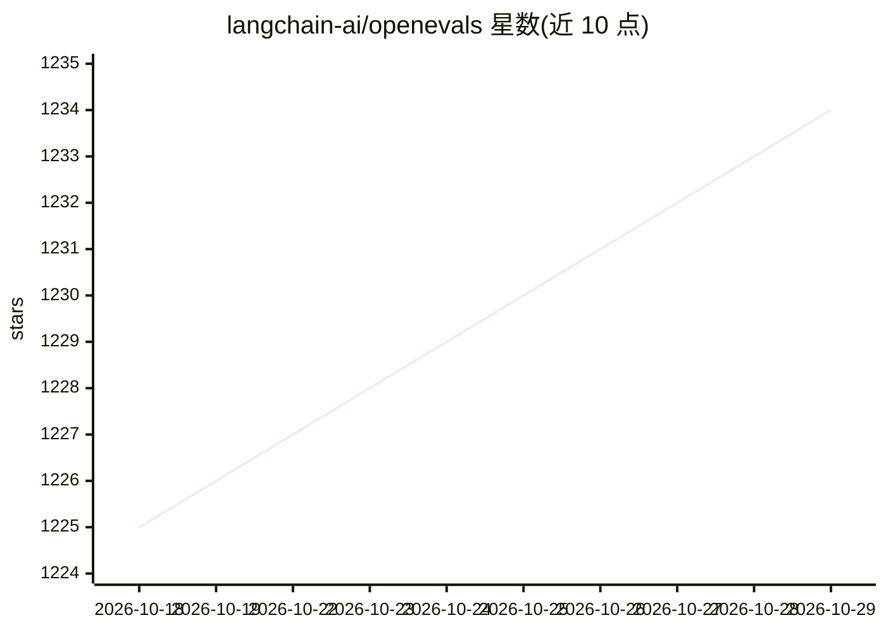

# langchain-ai/openevals

⭐ 1,234 · Python · MIT · 推送 2026-10-22 · [GitHub](https://github.com/langchain-ai/openevals) · 组织维护

**LLM 应用预置评测器库：提供 LLM-as-judge 等开箱评测**

LangChain 团队维护的 LLM 应用评测库，提供 Python 与 TypeScript 版本。核心为 create_llm_as_judge 函数，接收 prompt 与模型返回评测函数，内置正确性、简洁性等预置提示词，支持自定义 prompt 模板、few-shot、评分粒度（布尔/连续/多档分数）与输出 schema（TypedDict/Pydantic/Zod/JSON schema）。默认经 LangChain chat model 集成调用评判模型（默认安装 langchain_openai），也可直接传入 OpenAI 客户端，或以 PROVIDER:MODEL 形式指定如 anthropic:claude。

## 筛选速览

| 维度 | 判定 | 备注 |
|---|---|---|
| AI 角色 | `ai-ecosystem` | LLM/agent 周边工具 |
| 许可风险 | `permissive` | MIT |
| 部署形态 | `library` | 以包/库形式分发 |
| 模型依赖 | locked-api |  |
| 硬件要求 | — | 无带数字的原话,不猜 |
| 安装摩擦 | `low` | 无编译、无系统依赖或容器化 |
| 成熟度 | — | 结构信号不足 |

## 能力要点

- create_llm_as_judge：prompt+模型生成评测函数，自动解析评分为结果
- 内置 correctness/conciseness 等预置评测提示词
- 支持连续分数、choices 多档评分与自定义输出 schema
- 模型接入支持 LangChain 集成、直接传入 chat model 实例或 OpenAI 客户端

## 适用场景

- 为上线前的 LLM 应用输出做自动化评测
- 用 LLM-as-judge 对回答的正确性、简洁性打分
- 在 pytest/Vitest 等测试流程中集成评测并记录反馈

## 场景标签

`模型评测` · 领域:评测与运维

## 证据(README 行号)

> L3: Much like tests in traditional software, evals are an important part of bringing LLM applications to production.
> L115: This package contains the `create_llm_as_judge` function, which takes a prompt and a model as input, and returns a

## 星数曲线

2026-10-18 1,225 → 2026-10-29 1,234（+9）

---
*卡片 v1 · prompt 1.4 · 生成 2026-10-21 · 置信度 high · 依据 README sha `91fb7bd1e260` · [字段定义](../../DATASET.md)*
