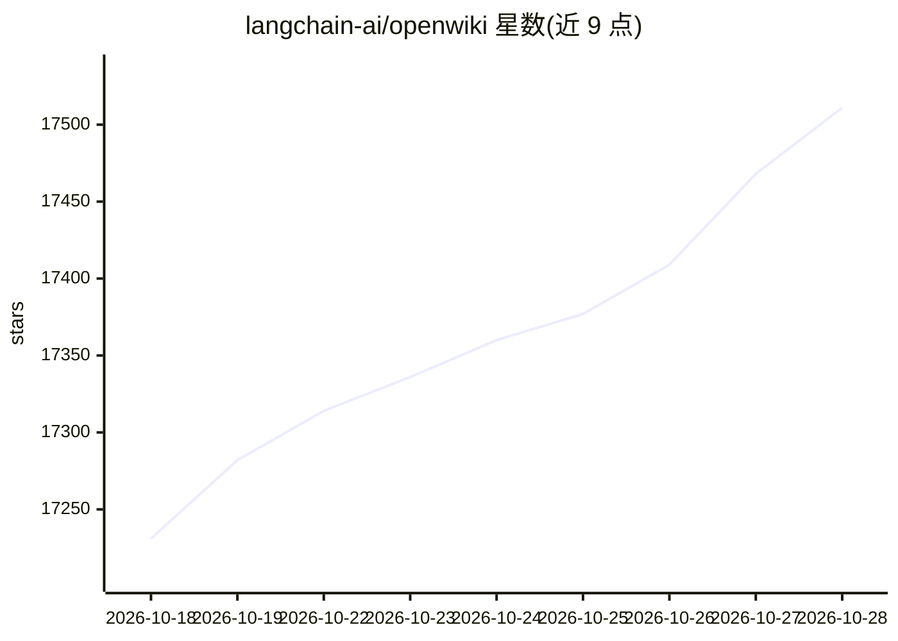

# langchain-ai/openwiki

⭐ 17,511 · TypeScript · MIT · 推送 2026-10-27 · [GitHub](https://github.com/langchain-ai/openwiki) · 组织维护

**为代码库生成并维护代理可读的 Markdown wiki 的 CLI**

OpenWiki 将代码库与知识源转换为相互链接的 Markdown wiki，供编码代理检索上下文、回答问题。工作流为：在编码代理内或通过独立 CLI 初始化 wiki，工具以 Claims 形式把事实追溯到源证据，后续更新只处理变更部分，支持中断恢复与逐页保存进度。可通过 openwiki link 将多个仓库组成 workspace 做跨库检索，内置本地可视化图谱与静态导出，并提供 GitHub Actions/GitLab CI/Bitbucket 定时更新模板。依赖 Node.js 22.22.0+。

## 筛选速览

| 维度 | 判定 | 备注 |
|---|---|---|
| AI 角色 | `ai-native` | 本体是模型或模型工具 |
| 许可风险 | `permissive` | MIT |
| 部署形态 | `library` | 以包/库形式分发 |
| 模型依赖 | — | README 未给出锁定关系 |
| 硬件要求 | — | 无带数字的原话,不猜 |
| 安装摩擦 | `low` | 无编译、无系统依赖或容器化 |
| 成熟度 | — | 结构信号不足 |

## 动量与使用信号

- 维护:`active` — 距上次 push 0.7 天,年发版 29,105 位贡献者
- 涨星:近 1 天 **+24**(自 20261016 起算)
- 安装:npm 包 `openwiki` 月下载 189,618
- 平台:— · 协议:OPENAI-API / MCP / OLLAMA

## 能力要点

- Claims 溯源机制：事实关联源证据，更新时识别需关注的部分
- 通过 MCP 生命周期工具（begin/submit_plan/next_page/…）与宿主代理协作
- openwiki link 组建跨仓库 workspace 检索与阅读
- 提供交互式图谱可视化与可发布的静态导出

## 适用场景

- 让编码代理快速理解陌生仓库的结构与上下文
- 多仓库服务通过 workspace 做统一文档检索
- 用 CI 定时任务保持代码文档与代码同步

## 场景标签

`知识库管理` `RAG` · 领域:知识与检索

## 证据(README 行号)

> L13: OpenWiki turns your codebase and knowledge sources into a linked Markdown wiki that you own. Your coding agent can 
> L30: The easiest way to get started is inside the coding agent you already use. OpenWiki uses that agent's authenticated
> L96: The MCP generation lifecycle is `openwiki_begin → openwiki_submit_plan → openwiki_next_page → openwiki_submit_page 

## 星数曲线

2026-10-18 17,231 → 2026-10-28 17,511（+280）

---
*卡片 v1 · prompt 1.4 · 生成 2026-10-18 · 置信度 high · 依据 README sha `22476650364e` · [字段定义](../../DATASET.md)*
