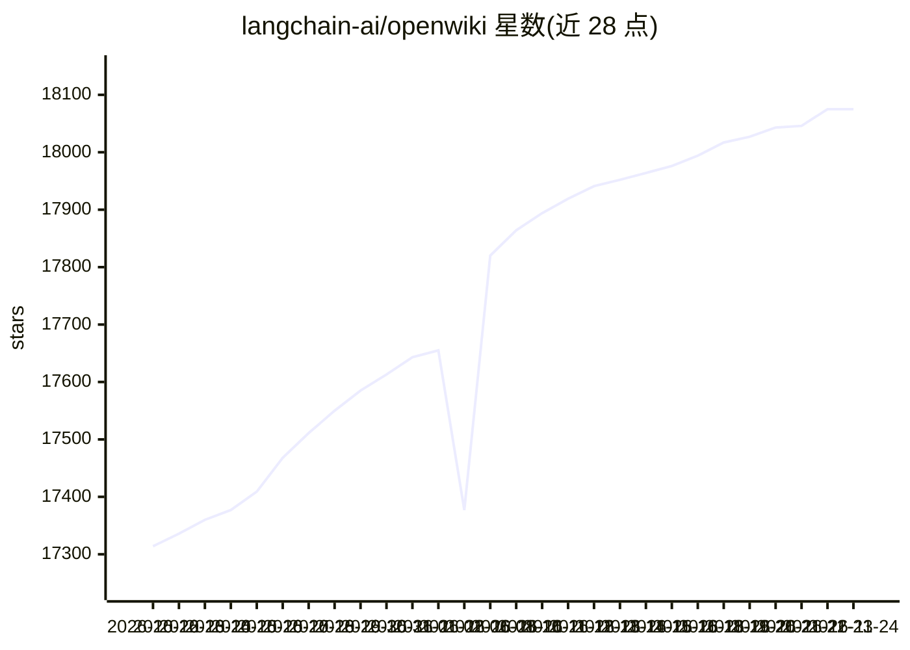

# langchain-ai/openwiki

⭐ 18,095 · TypeScript · MIT · 推送 2026-11-23 · [GitHub](https://github.com/langchain-ai/openwiki) · 组织维护

**为代码库生成并维护 Agent 可读 Markdown wiki 的 CLI**

OpenWiki 将代码库与知识源转换为带链接的 Markdown wiki，供编码 Agent 检索上下文、回答问题，也支持人工阅读与交互式图谱浏览。核心机制：以 Claims 溯源到源代码证据，更新时聚焦变更部分；提供 MCP 生命周期工具（begin/submit_plan/next_page/submit_page/finish）与只读检索工具 openwiki_search/openwiki_read。主路径是在既有编码 Agent 内运行（复用其已认证模型会话，无需另配模型提供方），也可用独立 CLI；支持多仓库 workspace 链接检索、断点续跑与 CI 定时更新。宿主集成目前仅支持仓库代码 wiki，暂不支持 connector 来源（含 LangSmith）。

## 筛选速览

| 维度 | 判定 | 备注 |
|---|---|---|
| AI 角色 | `ai-ecosystem` | LLM/agent 周边工具 |
| 许可风险 | `permissive` | MIT |
| 部署形态 | `library` | 以包/库形式分发 |
| 模型依赖 | — | README 未给出锁定关系 |
| 硬件要求 | — | 无带数字的原话,不猜 |
| 安装摩擦 | `low` | 无编译、无系统依赖或容器化 |
| 成熟度 | — | 结构信号不足 |

## 动量与使用信号

- 维护:`active` — 距上次 push 0.7 天,年发版 29,105 位贡献者
- 涨星:近 1 天 **+24**(自 20261016 起算)
- 安装:npm 包 `openwiki` 月下载 189,618
- 平台:— · 协议:OPENAI-API / MCP / OLLAMA

## 能力要点

- 将代码库转为带源证据溯源（Claims）的链接 Markdown wiki
- MCP 生成生命周期与只读检索工具，检索工具为本地、无模型调用
- openwiki link 将多仓库 wiki 组成 workspace 并跨仓检索
- 支持 CI 定时更新并生成文档 PR（GitHub Actions/GitLab/Bitbucket）

## 适用场景

- 让编码 Agent 快速理解陌生仓库并查找上下文
- 为跨多个仓库的服务建立统一可检索文档
- 代码变更后自动增量更新 wiki 并提交 docs PR
- 以交互式图谱浏览和发布静态可视化文档

## 场景标签

`知识库管理` `编码 Agent` · 领域:编码与开发

## 证据(README 行号)

> L13: OpenWiki turns your codebase and knowledge sources into a linked Markdown wiki that you own. Your coding agent can 
> L30: The easiest way to get started is inside the coding agent you already use. OpenWiki uses that agent's authenticated
> L43: ### 2. Connect your coding agent

## 星数曲线

2026-10-22 17,314 → 2026-11-24 18,075（+761）

---
*卡片 v1 · prompt 1.4 · 生成 2026-11-22 · 置信度 high · 依据 README sha `641910662941` · [字段定义](../../DATASET.md)*
