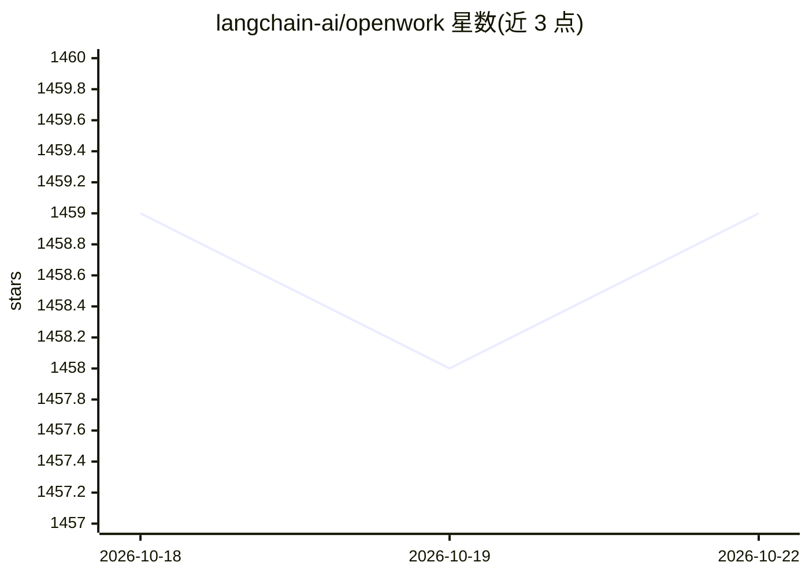

# langchain-ai/openwork

⭐ 1,459 · TypeScript · MIT · 推送 2026-10-21 · [GitHub](https://github.com/langchain-ai/openwork) · 组织维护

**deepagentsjs 桌面端：AI agent 的文件系统与规划界面**

langchain-ai 维护的桌面应用，为 deepagentsjs 提供图形界面：支持文件系统访问、规划和子代理委派的 agent 构建。README 明确警告 agent 可直接访问文件系统并执行 shell 命令，需审查工具调用并在可信工作区运行。支持 Anthropic、OpenAI、Google 三家模型，通过 npx 直接运行或 npm 全局安装，需 Node.js 18+，也可从源码构建。MIT 许可。

## 筛选速览

| 维度 | 判定 | 备注 |
|---|---|---|
| AI 角色 | `ai-ecosystem` | LLM/agent 周边工具 |
| 许可风险 | `permissive` | MIT |
| 部署形态 | `library` | 以包/库形式分发 |
| 模型依赖 | locked-api |  |
| 硬件要求 | — | 无带数字的原话,不猜 |
| 安装摩擦 | `low` | 无编译、无系统依赖或容器化 |
| 成熟度 | — | 结构信号不足 |

## 能力要点

- deepagentsjs 的桌面界面，具备文件系统能力、规划与子代理委派
- 支持 Anthropic / OpenAI / Google 多家模型
- npx 直接运行或 npm 全局安装
- 可执行 shell 命令，需人工审查工具调用

## 适用场景

- 在桌面环境中构建和运行带文件系统能力的 deep agent
- 通过设置面板配置并切换不同模型提供商

## 场景标签

`Agent 框架` · 领域:Agent 开发

## 证据(README 行号)

> L5: A desktop interface for deepagentsjs — an opinionated harness for building deep agents with filesystem capabilities 
> L38: |Provider|Models|

## 星数曲线

2026-10-18 1,459 → 2026-10-22 1,459（+0）

---
*卡片 v1 · prompt 1.4 · 生成 2026-10-21 · 置信度 high · 依据 README sha `abe47bf2a889` · [字段定义](../../DATASET.md)*
