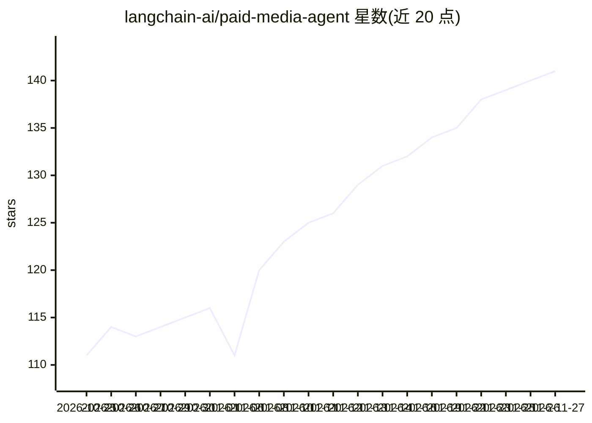

# langchain-ai/paid-media-agent

⭐ 141 · Python · Apache-2.0 · 推送 2026-11-24 · [GitHub](https://github.com/langchain-ai/paid-media-agent) · 组织维护

**部署到 Slack 的广告投放分析 Agent，覆盖多平台报表与预算变更审批**

基于 Deep Agents 构建的付费媒体分析 agent，部署到团队 Slack 后可通过对话查询广告账户变化：对比 Google/Meta/LinkedIn/TikTok/Reddit/X 等平台的广告活动表现（花费、转化、单线索成本、ROAS），按周/月发送 HTML 报告，并起草预算或状态变更供人工审批。模型决定调查方向，代码计算所有指标并与源数据核对；实时写操作默认关闭，需审批策略、发布检查与授权人批准。依赖 LangSmith 账户、模型 key 和 Pipeboard token；可本地演示（无需 key）、Managed Deep Agents 部署或 Docker 自托管。

## 筛选速览

| 维度 | 判定 | 备注 |
|---|---|---|
| AI 角色 | `ai-native` | 本体是模型或模型工具 |
| 许可风险 | `permissive` | Apache-2.0 |
| 部署形态 | `self-host` | docker 或自建部署 |
| 模型依赖 | — | README 未给出锁定关系 |
| 硬件要求 | — | 无带数字的原话,不猜 |
| 安装摩擦 | `low` | 无编译、无系统依赖或容器化 |
| 成熟度 | — | 结构信号不足 |

## 能力要点

- 多平台广告活动对比与异动归因，缺失数据不按零处理
- 周/月定时报告以 HTML 渲染（自托管含 WeasyPrint 可出 PDF）
- 变更需对具体提案的持久化审批，支持 kill switch
- 后台异步只读 subagent 按任务选择模型，可预约回访检查

## 适用场景

- 在 Slack 里询问广告账户上周哪些变化及其原因
- 自动向团队频道发送周报/月报与图表
- 起草预算调整提案并走人工审批流程
- 对合成账户做无 key 的本地演示与开发定制

## 场景标签

`数据分析` · 领域:效率与自动化

## 证据(README 行号)

> L8:  A paid-media analyst for your team's Slack. Built on Deep Agents. Deploys with Managed Deep Agents.
> L26: **Ask it in Slack what changed across your ad accounts, and what to do about it.** Paid Media
> L101: Paid Media Agent is a Deep Agents agent deployed on

## 星数曲线

2026-10-25 111 → 2026-11-27 141（+30）

---
*卡片 v1 · prompt 1.4 · 生成 2026-11-27 · 置信度 high · 依据 README sha `f47b00bc59df` · [字段定义](../../DATASET.md)*
