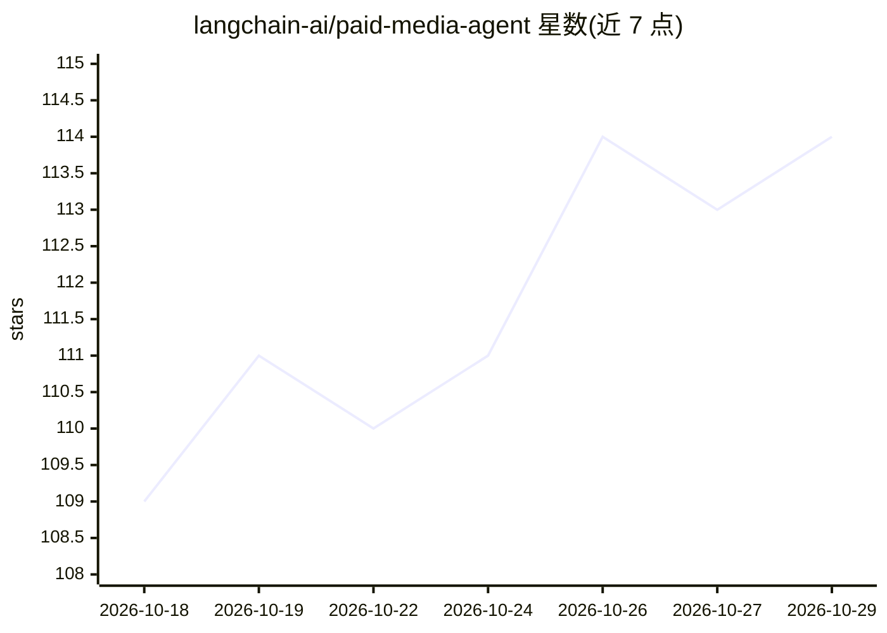

# langchain-ai/paid-media-agent

⭐ 114 · Python · Apache-2.0 · 推送 2026-10-25 · [GitHub](https://github.com/langchain-ai/paid-media-agent) · 组织维护

**跨渠道广告代理：分析 Google/Meta 等广告效果并生成报告**

基于 Deep Agents 构建的付费广告代理，面向运营广告账户的团队：连接 Google Ads、Meta Ads、Reddit、LinkedIn、X Ads、OpenAI Ads 等平台，在 Slack 或终端回答投放问题、生成含图表的周/月报告（HTML/PDF），并准备待审批的投放变更。模型决定调查路径，指标由代码计算并核对数据；实时账户变更默认关闭，启用需写策略与授权审批。通过 Managed Deep Agents 托管部署（付费）或 Docker 自托管，要求 Python 3.11+ 与 uv。

## 筛选速览

| 维度 | 判定 | 备注 |
|---|---|---|
| AI 角色 | `ai-native` | 本体是模型或模型工具 |
| 许可风险 | `permissive` | Apache-2.0 |
| 部署形态 | `self-host` | docker 或自建部署 |
| 模型依赖 | — | README 未给出锁定关系 |
| 硬件要求 | — | 无带数字的原话,不猜 |
| 安装摩擦 | `low` | 无编译、无系统依赖或容器化 |
| 成熟度 | — | 结构信号不足 |

## 能力要点

- 接入 10 个广告/分析平台（Pipeboard MCP + 直连只读适配器）
- 生成含图表与建议的周/月报告，代码核对报告数字与源数据
- 变更提案默认不执行，启用需写策略、发布检查与授权审批
- 无需模型密钥或广告账户即可运行离线演示

## 适用场景

- 跨平台对比广告花费、转化与单位成本表现
- 定位投放指标变化背后的具体广告系列
- 按周/月自动生成可下载的投放报告并推送到 Slack
- 提出广告变更提案并走审批流程后执行

## 场景标签

`数据分析` · 领域:效率与自动化

## 证据(README 行号)

> L7:  Paid Media Agent
> L21: Paid Media Agent helps you understand what changed across your ad accounts and decide what to do
> L22: next. Ask questions in Slack or the terminal, generate performance reports, and prepare campaign

## 星数曲线

2026-10-18 109 → 2026-10-29 114（+5）

---
*卡片 v1 · prompt 1.4 · 生成 2026-10-23 · 置信度 high · 依据 README sha `036d7a73cb8f` · [字段定义](../../DATASET.md)*
