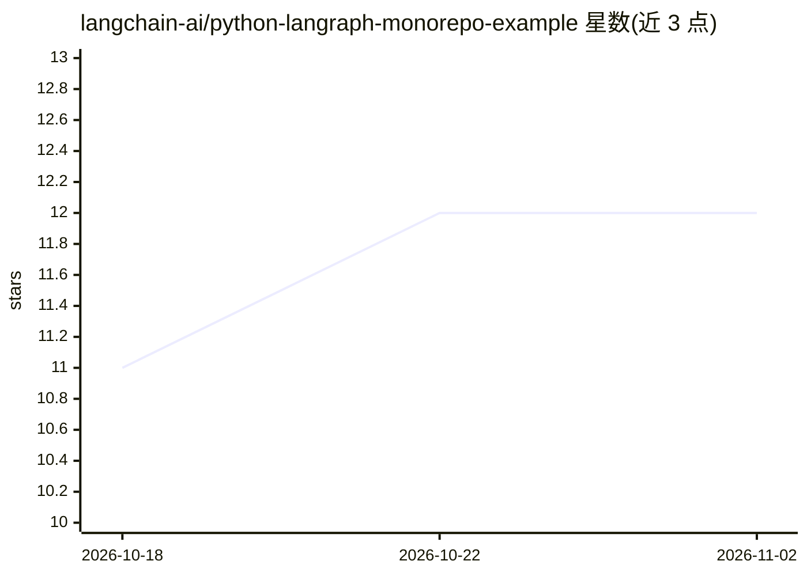

# langchain-ai/python-langraph-monorepo-example

⭐ 12 · Python · 推送 2026-07-15 · [GitHub](https://github.com/langchain-ai/python-langraph-monorepo-example) · 组织维护

**LangGraph Platform 部署的 Python monorepo 示例工程**

langchain-ai 维护的示例仓库，演示如何以 Python monorepo 结构组织多个 LangGraph agent 并部署到 LangGraph Platform：libs/shared 为带 pyproject.toml 的真实共享包，libs/common 为无 pyproject.toml 的目录式包，根 pyproject.toml 管理共享依赖，各 agent 通过 langgraph.json 的 dependencies 字段引用共享代码。使用 LangGraph CLI（langgraph build/up）按 agent 独立构建运行。面向使用 LangGraph Platform 的开发者。

## 筛选速览

| 维度 | 判定 | 备注 |
|---|---|---|
| AI 角色 | `ai-ecosystem` | LLM/agent 周边工具 |
| 许可风险 | `none` | — |
| 部署形态 | `None` |  |
| 模型依赖 | — | README 未给出锁定关系 |
| 硬件要求 | — | 无带数字的原话,不猜 |
| 安装摩擦 | `low` | 无编译、无系统依赖或容器化 |
| 成熟度 | — | 结构信号不足 |

## 能力要点

- libs/shared 真实包与 libs/common 目录式包两种共享方式
- 根 pyproject.toml 管理全部 agent 的共享依赖
- 每个 agent 独立 langgraph.json 与 pyproject.toml，可用 LangGraph CLI 单独构建运行

## 适用场景

- 学习多 agent 工程如何复用共享工具函数
- 在 LangGraph Platform 上以 monorepo 方式组织与部署多个 agent

## 场景标签

`Agent 框架` · 领域:Agent 开发

## 证据(README 行号)

> L1: # LangGraph Monorepo Example
> L3: A Python monorepo example demonstrating LangGraph agents with shared packages.
> L29: Each agent can be run independently using the LangGraph CLI, and both will have access to the shared utility functi

## 星数曲线

2026-10-18 11 → 2026-11-02 12（+1）

---
*卡片 v1 · prompt 1.4 · 生成 2026-11-01 · 置信度 high · 依据 README sha `3a157b55ea61` · [字段定义](../../DATASET.md)*
