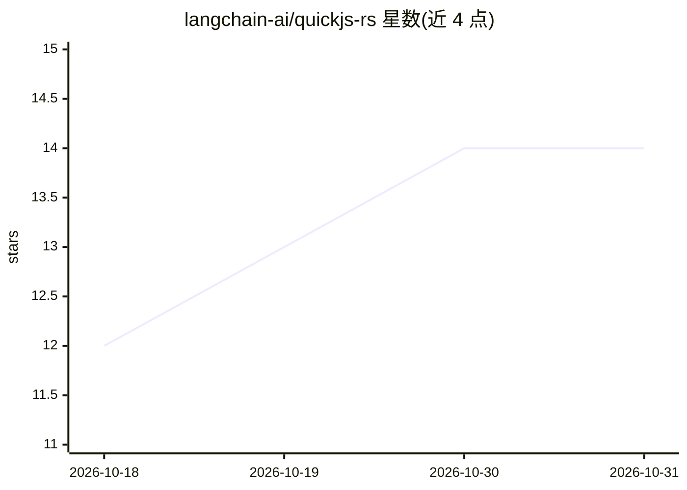

# langchain-ai/quickjs-rs

⭐ 14 · Python · NOASSERTION · 推送 2026-10-29 · [GitHub](https://github.com/langchain-ai/quickjs-rs) · 组织维护

**在 WebAssembly 沙箱中执行 JavaScript 的 Python 库**

纯 Python 包，将 quickjs-ng 经 rquickjs 编译为 wasm32-wasip1，由 wasmtime 驱动，在 WebAssembly 线性内存沙箱内执行不可信 JS：引擎无法访问宿主指针。支持宿主 loader 回调解析 ES 模块、OXC 转换剥离内联 TypeScript、整堆快照保存/恢复、内存上限与超时中断等资源限制。单一通用 wheel，唯一运行时依赖 wasmtime，需 Python 3.11+。README 自声明为实验性，投产前需阅读安全指南。

## 筛选速览

| 维度 | 判定 | 备注 |
|---|---|---|
| AI 角色 | `ai-ecosystem` | LLM/agent 周边工具 |
| 许可风险 | `none` | NOASSERTION |
| 部署形态 | `library` | 以包/库形式分发 |
| 模型依赖 | — | README 未给出锁定关系 |
| 硬件要求 | — | 无带数字的原话,不猜 |
| 安装摩擦 | `low` | 无编译、无系统依赖或容器化 |
| 成熟度 | `idea` | |

## 能力要点

- quickjs-ng 编译为 wasm 由 wasmtime 驱动，沙箱内执行不可信 JS
- 宿主 loader 回调解析 ES 模块，normalize 返回 None 拒绝加载
- TypeScript 类型剥离（OXC 转换 .wasm），无类型检查
- 整堆快照与恢复（含 build_id 校验）、内存上限与超时中断

## 适用场景

- 在 Python 服务中安全执行不可信 JavaScript 代码
- 为 agent/工具调用提供隔离的 JS 运行环境
- 需要快照/恢复 JS 执行状态的场景

## 场景标签

 · 领域:开发工具/沙箱运行时

## 证据(README 行号)

> L3: Sandboxed JavaScript execution for Python.
> L5: JS runs inside a WebAssembly sandbox: quickjs-ng (a QuickJS fork) via rquickjs is compiled to `wasm32-wasip1` and dr

## 星数曲线

2026-10-18 12 → 2026-10-31 14（+2）

---
*卡片 v1 · prompt 1.4 · 生成 2026-10-31 · 置信度 mid · 依据 README sha `a97b9cc5bca8` · [字段定义](../../DATASET.md)*
