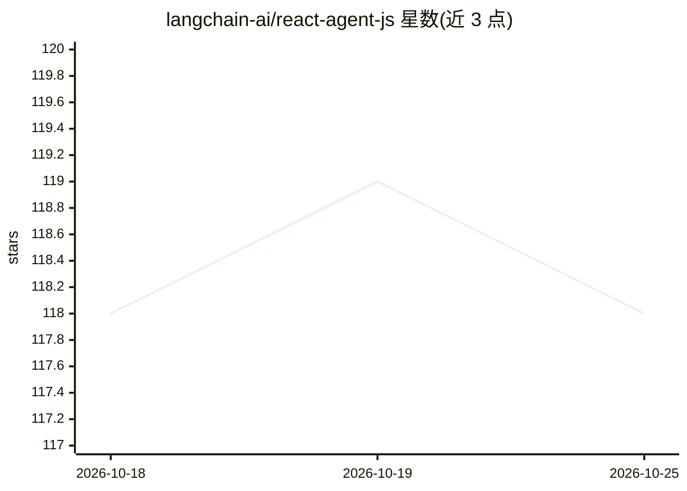

# langchain-ai/react-agent-js

⭐ 118 · TypeScript · MIT · 推送 2026-10-23 · [GitHub](https://github.com/langchain-ai/react-agent-js) · 组织维护

**面向开发者的 LangChain AI Agent 应用起始模板**

基于 LangChain `createAgent` 与 LangGraph 的 TypeScript 起始模板，供开发者快速搭建带工具调用的 agentic 应用。内置计算器、时间、天气与知识搜索四个示例工具，工具用 Zod schema 定义；支持中间件（摘要、human-in-the-loop 等）扩展，可配置 Anthropic 或 OpenAI 模型，并集成 LangSmith 追踪与 LangGraph Studio 可视化调试。通过 git clone 与 pnpm 安装运行，MIT 许可。

## 筛选速览

| 维度 | 判定 | 备注 |
|---|---|---|
| AI 角色 | `ai-ecosystem` | LLM/agent 周边工具 |
| 许可风险 | `permissive` | MIT |
| 部署形态 | `library` | 以包/库形式分发 |
| 模型依赖 | locked-api |  |
| 硬件要求 | — | 无带数字的原话,不猜 |
| 安装摩擦 | `low` | 无编译、无系统依赖或容器化 |
| 成熟度 | — | 结构信号不足 |

## 能力要点

- createAgent 接口 + Zod schema 定义工具，TypeScript 全类型安全
- 内置 4 个示例工具与中间件扩展机制（摘要、human-in-the-loop）
- 支持 Anthropic 与 OpenAI 模型切换配置
- LangSmith 自动追踪与 LangGraph Studio 可视化调试

## 适用场景

- 以模板起步快速搭建带工具调用的 AI agent 应用
- 在 LangGraph Studio 中可视化调试 agent 的图结构与工具调用
- 学习 LangChain v1 的工具定义与中间件用法

## 场景标签

`Agent 框架` · 领域:Agent 开发

## 证据(README 行号)

> L5: A modern starter template for building agentic applications using **LangChain** and `createAgent`. This template pro
> L11: - **LangChain API** - Uses `createAgent` for a clean, simple interface

## 星数曲线

2026-10-18 118 → 2026-10-25 118（+0）

---
*卡片 v1 · prompt 1.4 · 生成 2026-10-23 · 置信度 high · 依据 README sha `945445b63792` · [字段定义](../../DATASET.md)*
