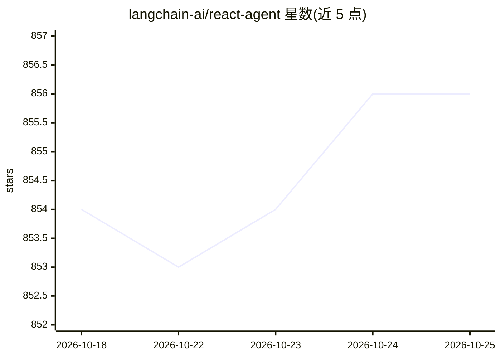

# langchain-ai/react-agent

⭐ 856 · Python · MIT · 推送 2026-10-23 · [GitHub](https://github.com/langchain-ai/react-agent) · 组织维护

**LangGraph 官方 ReAct agent 模板，供 Studio 中构建定制 agent**

基于 LangGraph 实现的 ReAct agent 模板，面向 LangGraph Studio 设计。核心逻辑在 src/react_agent/graph.py 中：接收用户查询，循环执行“推理—选择动作—调用工具—观察结果”，直到产出最终回答。默认使用 Tavily 搜索工具，模型默认 claude-sonnet-4-5-20250929，可通过环境变量切换 Anthropic 或 OpenAI 的 API key，并支持在 tools.py 添加自定义工具、修改 prompts 与 graph.py 中的推理流程。需先安装 LangGraph Studio 并配置 .env 文件后使用。

## 筛选速览

| 维度 | 判定 | 备注 |
|---|---|---|
| AI 角色 | `ai-ecosystem` | LLM/agent 周边工具 |
| 许可风险 | `permissive` | MIT |
| 部署形态 | `None` |  |
| 模型依赖 | locked-api |  |
| 硬件要求 | — | 无带数字的原话,不猜 |
| 安装摩擦 | `low` | 无编译、无系统依赖或容器化 |
| 成熟度 | — | 结构信号不足 |

## 能力要点

- graph.py 中定义可扩展的 ReAct 循环（推理-工具-观察迭代）
- 默认 Tavily 搜索工具，可添加任意 Python 函数作为自定义工具
- 支持 Anthropic / OpenAI 聊天模型切换与自定义系统提示词
- 支持热重载、从历史状态重跑与 LangSmith 追踪集成

## 适用场景

- 在 LangGraph Studio 中快速起一个可定制的 ReAct agent 原型
- 以此模板为基础扩展自定义工具与提示词构建应用
- 调试 agent 图结构：编辑历史状态、加中断点、重跑节点

## 场景标签

`Agent 框架` · 领域:Agent 开发

## 证据(README 行号)

> L4: Open in - LangGraph Studio
> L6: This template showcases a ReAct agent implemented using LangGraph, designed for LangGraph Studio. ReAct agents are u

## 星数曲线

2026-10-18 854 → 2026-10-25 856（+2）

---
*卡片 v1 · prompt 1.4 · 生成 2026-10-21 · 置信度 high · 依据 README sha `4e1059ab568c` · [字段定义](../../DATASET.md)*
