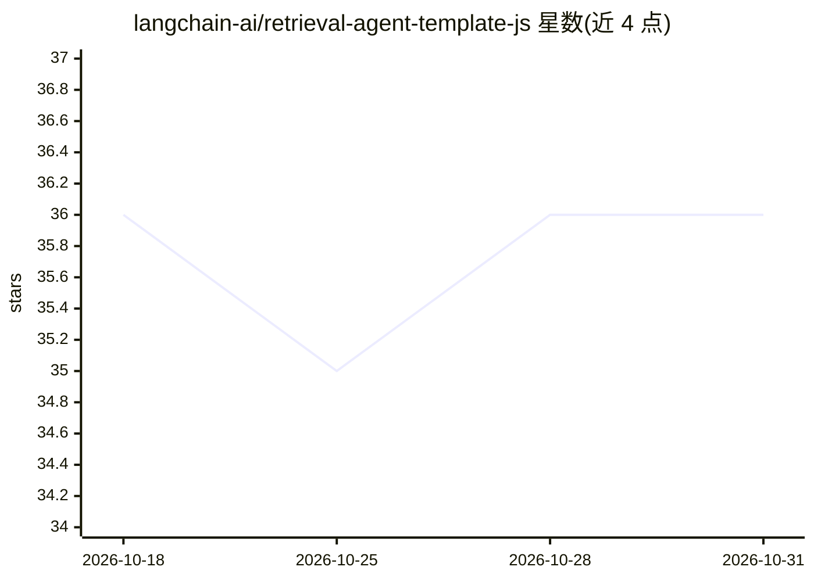

# langchain-ai/retrieval-agent-template-js

⭐ 36 · TypeScript · MIT · 推送 2026-10-30 · [GitHub](https://github.com/langchain-ai/retrieval-agent-template-js) · 组织维护

**LangGraph.js 检索问答 agent 起步模板**

基于 LangGraph.js 与 LangGraph Studio 的检索问答 agent 起步项目，含两个图：index 图将文档按 userId 索引到所配置的向量存储，retrieval 图基于对话历史检索并生成回答。检索器支持 Elasticsearch（Elastic Cloud 或本地 Docker）、MongoDB Atlas、Pinecone Serverless 三种可选后端；模型默认 Anthropic Claude 系列，可选 OpenAI 等，嵌入模型支持 OpenAI 与 Cohere。通过 .env 配置访问凭据，可自定义检索器、嵌入模型、搜索参数、提示词与图结构。

## 筛选速览

| 维度 | 判定 | 备注 |
|---|---|---|
| AI 角色 | `ai-ecosystem` | LLM/agent 周边工具 |
| 许可风险 | `permissive` | MIT |
| 部署形态 | `self-host` | docker 或自建部署 |
| 模型依赖 | — | README 未给出锁定关系 |
| 硬件要求 | — | 无带数字的原话,不猜 |
| 安装摩擦 | `low` | 无编译、无系统依赖或容器化 |
| 成熟度 | — | 结构信号不足 |

## 能力要点

- index 与 retrieval 双图：按 userId 索引并过滤个性化检索
- 三种可选向量存储：Elasticsearch / MongoDB Atlas / Pinecone
- 默认模型 Anthropic Claude，可选 OpenAI、Fireworks AI 等
- 可自定义图节点、工具、提示词与搜索参数

## 适用场景

- 作为 LangGraph.js 检索 agent 开发的起步模板
- 快速搭建基于个人文档索引的检索问答原型
- 在 LangGraph Studio 中调试与定制 agent 图结构

## 场景标签

`RAG` `Agent 框架` · 领域:Agent 开发

## 证据(README 行号)

> L5: This is a starter project to help you get started with developing a retrieval agent using LangGraph.js in LangGraph 
> L9: It contains example graphs exported from `src/retrieval_agent/graph.ts` that implement a retrieval-based question an

## 星数曲线

2026-10-18 36 → 2026-10-31 36（+0）

---
*卡片 v1 · prompt 1.4 · 生成 2026-10-25 · 置信度 mid · 依据 README sha `92ac4972a553` · [字段定义](../../DATASET.md)*
