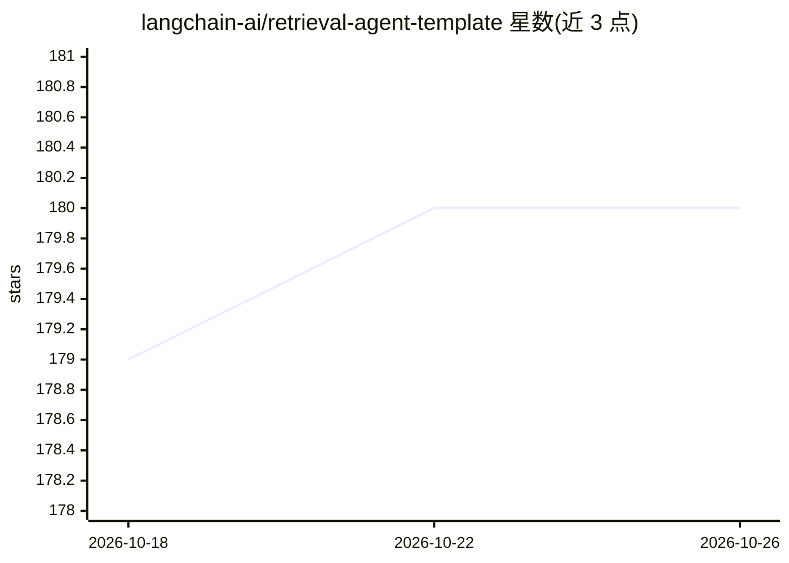

# langchain-ai/retrieval-agent-template

⭐ 180 · Python · MIT · 推送 2026-10-22 · [GitHub](https://github.com/langchain-ai/retrieval-agent-template) · 组织维护

**LangGraph 检索问答 Agent 起步模板，供开发者定制**

基于 LangGraph 的检索式问答 Agent 起步项目，含索引图与检索图：前者将文档按 user_id 建入索引，后者结合会话历史检索并生成个性化回答。检索后端可选 Elasticsearch（默认）、MongoDB Atlas、Pinecone，模型与嵌入模型（Anthropic/OpenAI/Cohere 等）通过 .env 配置切换，需配合 LangGraph Studio 使用。支持修改检索参数、提示词、扩展图节点与工具。

## 筛选速览

| 维度 | 判定 | 备注 |
|---|---|---|
| AI 角色 | `ai-ecosystem` | LLM/agent 周边工具 |
| 许可风险 | `permissive` | MIT |
| 部署形态 | `self-host` | docker 或自建部署 |
| 模型依赖 | locked-api |  |
| 硬件要求 | — | 无带数字的原话,不猜 |
| 安装摩擦 | `low` | 无编译、无系统依赖或容器化 |
| 成熟度 | — | 结构信号不足 |

## 能力要点

- 索引图 + 检索图的双图结构，按 user_id 过滤实现个性化检索
- 三种可选检索后端：Elasticsearch（默认）/MongoDB Atlas/Pinecone
- 响应模型、查询模型与嵌入模型均可通过配置切换
- 支持扩展图节点、自定义工具与提示词

## 适用场景

- 基于 LangGraph Studio 快速搭建个性化文档问答应用
- 以该模板为起点定制自己的检索 Agent
- 对比切换不同向量库与模型提供商的效果

## 场景标签

`Agent 框架` `文档问答` `RAG` · 领域:Agent 开发

## 证据(README 行号)

> L6: This is a starter project to help you get started with developing a retrieval agent using LangGraph in LangGraph Stu
> L10: It contains example graphs exported from `src/retrieval_agent/graph.py` that implement a retrieval-based question a
> L14: This project has two graphs: an "index" graph, and a "retrieval" graph.

## 星数曲线

2026-10-18 179 → 2026-10-26 180（+1）

---
*卡片 v1 · prompt 1.4 · 生成 2026-10-22 · 置信度 mid · 依据 README sha `3aa9c6cd2dd6` · [字段定义](../../DATASET.md)*
