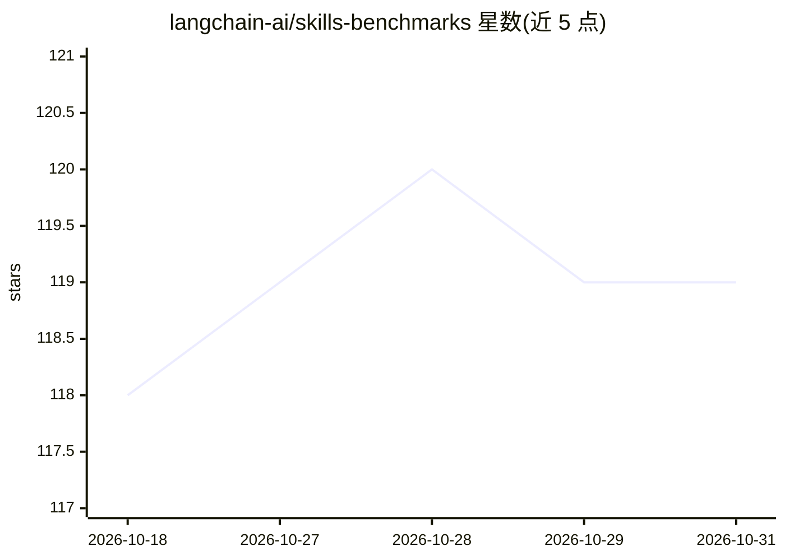

# langchain-ai/skills-benchmarks

⭐ 119 · JavaScript · MIT · 推送 2026-09-21 · [GitHub](https://github.com/langchain-ai/skills-benchmarks) · 组织维护

**评测技能文档设计对 Claude Code 行为遵从度影响的基准测试框架**

由 langchain-ai 维护的基准测试框架：衡量技能（skills）文档设计如何影响 Claude Code 对推荐模式的遵从度。包含 21 个自包含基准任务（LangChain/LangSmith/LangGraph/Deep Agents 相关，覆盖 SQL 分析 agent、框架选型、bug 修复、追踪接入等类别）与按类别组织的 treatment 技能配置组合；任务与 treatment 解耦可自由搭配。执行流程为在 Docker 中运行 Claude Code CLI、对产物做配置驱动的校验，结果记录到本地目录与 LangSmith 实验。默认测试 Claude Sonnet 4.6，可用 BENCH_CC_MODEL 覆盖；需 Python 3.11+/Node.js 20+/Docker/Claude Code CLI 及三个 API key。

## 筛选速览

| 维度 | 判定 | 备注 |
|---|---|---|
| AI 角色 | `ai-ecosystem` | LLM/agent 周边工具 |
| 许可风险 | `permissive` | MIT |
| 部署形态 | `library` | 以包/库形式分发 |
| 模型依赖 | locked-api |  |
| 硬件要求 | — | 无带数字的原话,不猜 |
| 安装摩擦 | `low` | 无编译、无系统依赖或容器化 |
| 成熟度 | — | 结构信号不足 |

## 能力要点

- 21 个任务与 7 类 treatment 技能配置解耦组合
- Docker 沙箱内执行 Claude Code CLI 并配置驱动校验产物
- 结果写入本地 logs/experiments 目录与 LangSmith 实验（含 trace 嵌套）
- 提供 pytest（推荐）与 vitest 两种运行器

## 适用场景

- 度量技能文档设计对 Claude Code 遵从推荐模式的影响
- 对比不同技能组合在基准任务上的通过率与耗时
- 将技能基准结果作为 LangSmith 实验进行追踪分析

## 场景标签

`模型评测` · 领域:评测与运维

## 证据(README 行号)

> L3: Measures how skill documentation design affects Claude Code's adherence to recommended patterns.
> L101: 4. **Report**: Logs results to local experiment directory and LangSmith

## 星数曲线

2026-10-18 118 → 2026-10-31 119（+1）

---
*卡片 v1 · prompt 1.4 · 生成 2026-10-23 · 置信度 mid · 依据 README sha `062331e2bb7b` · [字段定义](../../DATASET.md)*
