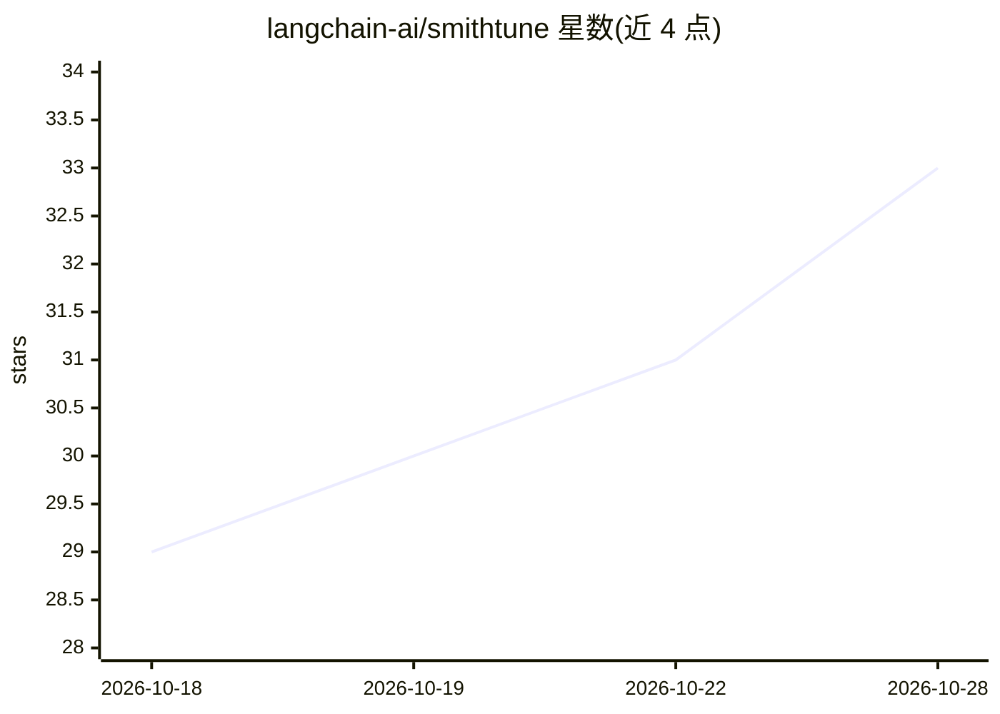

# langchain-ai/smithtune

⭐ 33 · Python · MIT · 推送 2026-10-28 · [GitHub](https://github.com/langchain-ai/smithtune) · 组织维护

**基于 LangSmith 轨迹数据做模型后训练（微调）的 CLI 工具**

smithtune 是 LangChain 团队提供的命令行工具，用于把 LangSmith 中记录的 agent 轨迹整理成微调数据集，在 Fireworks 或 Baseten 上训练模型，在 LangSmith 中对比基线与微调模型，并可选择性部署推理端点。流程为 dataset pull →（可选 triage 由多模型评审团投票筛选轨迹）→ push → prepare → plan → train --evaluate → deploy。付费操作（训练/评测/部署）需 --confirm 显式确认；项目自述为早期 beta，命令与目录格式可能随版本变化。

## 筛选速览

| 维度 | 判定 | 备注 |
|---|---|---|
| AI 角色 | `ai-ecosystem` | LLM/agent 周边工具 |
| 许可风险 | `permissive` | MIT |
| 部署形态 | `library` | 以包/库形式分发 |
| 模型依赖 | — | README 未给出锁定关系 |
| 硬件要求 | — | 无带数字的原话,不猜 |
| 安装摩擦 | `low` | 无编译、无系统依赖或容器化 |
| 成熟度 | `idea` | |

## 能力要点

- 从 LangSmith 追踪项目拉取轨迹并构建微调数据集
- 支持 Fireworks 与 Baseten 两家训练服务商及多种模型
- 可选多模型 agent 评审团（council）按 rubric 投票筛选训练轨迹
- 训练后自动按最低验证损失选 checkpoint，并在测试集上与基线模型对比
- 提供 smithtune skill，可由 Claude Code、Codex、Cursor 等编码 agent 驱动全流程

## 适用场景

- 把我应用里积累的高质量 agent 轨迹变成微调数据
- 在 Fireworks/Baseten 上微调 Qwen、DeepSeek 等模型并对比效果
- 让 AI 编码助手自动执行从取数到训练部署的完整流程

## 场景标签

`微调` · 领域:训练与推理

## 证据(README 行号)

> L3: Fine-tune models on trajectories
> L4: recorded in LangSmith. Train with Fireworks or Baseten, compare the base and tuned models
> L46: prepare → plan → train --evaluate → deploy (optional)

## 星数曲线

2026-10-18 29 → 2026-10-28 33（+4）

---
*卡片 v1 · prompt 1.4 · 生成 2026-10-26 · 置信度 mid · 依据 README sha `7efd575de483` · [字段定义](../../DATASET.md)*
