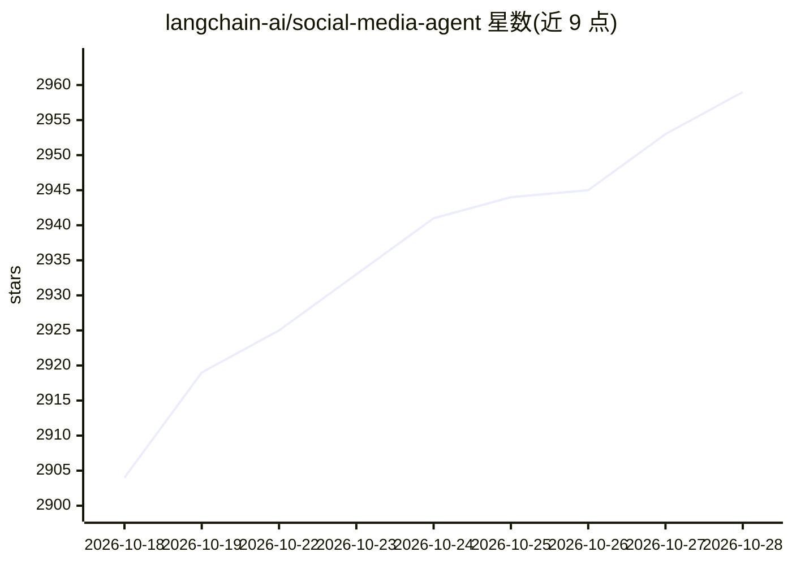

# langchain-ai/social-media-agent

⭐ 2,959 · TypeScript · MIT · 推送 2026-10-26 · [GitHub](https://github.com/langchain-ai/social-media-agent) · 组织维护

**生成并发布 Twitter/LinkedIn 帖子的 HITL 社媒 agent**

LangChain 团队维护的社交内容发布 agent：输入一个 URL，读取内容并生成 Twitter 与 LinkedIn 帖文，通过 human-in-the-loop 流程处理社交平台认证，并允许用户修改、接受或拒绝生成结果。基于 LangGraph server 运行，LLM 使用 Anthropic API，网页抓取用 FireCrawl，社交平台认证可通过 Arcade 或自有 Twitter/LinkedIn 开发者账号。完整模式额外支持 GitHub/Twitter/YouTube 内容解析、Slack 数据摄取与更新推送、图片选择上传（存 Supabase）；基础模式不含这些功能。安装需 git clone、yarn install 与 LangGraph CLI。

## 筛选速览

| 维度 | 判定 | 备注 |
|---|---|---|
| AI 角色 | `ai-native` | 本体是模型或模型工具 |
| 许可风险 | `permissive` | MIT |
| 部署形态 | `library` | 以包/库形式分发 |
| 模型依赖 | — | README 未给出锁定关系 |
| 硬件要求 | — | 无带数字的原话,不猜 |
| 安装摩擦 | `low` | 无编译、无系统依赖或容器化 |
| 成熟度 | — | 结构信号不足 |

## 能力要点

- 从 URL 内容生成 Twitter 与 LinkedIn 帖文
- HITL 流程：用户可修改、接受或拒绝生成结果
- 两种授权方式：Arcade 或自有 Twitter/LinkedIn 开发者账号
- 可选 Slack 频道摄取链接并按 cron 定时生成帖文

## 适用场景

- 把博客或网页内容转成社媒帖文并人工审核后发布
- 在 Slack 频道汇集链接，定时批量生成社媒内容
- 以个人或公司主页身份发布 LinkedIn 帖文

## 场景标签

`AI 写作` · 领域:内容生成

## 证据(README 行号)

> L3: This repository contains an 'agent' which can take in a URL, and generate a Twitter & LinkedIn post based on the con
> L121: Screenshot of the social media agent graph

## 星数曲线

2026-10-18 2,904 → 2026-10-28 2,959（+55）

---
*卡片 v1 · prompt 1.4 · 生成 2026-10-21 · 置信度 mid · 依据 README sha `a06bbfe3d75c` · [字段定义](../../DATASET.md)*
