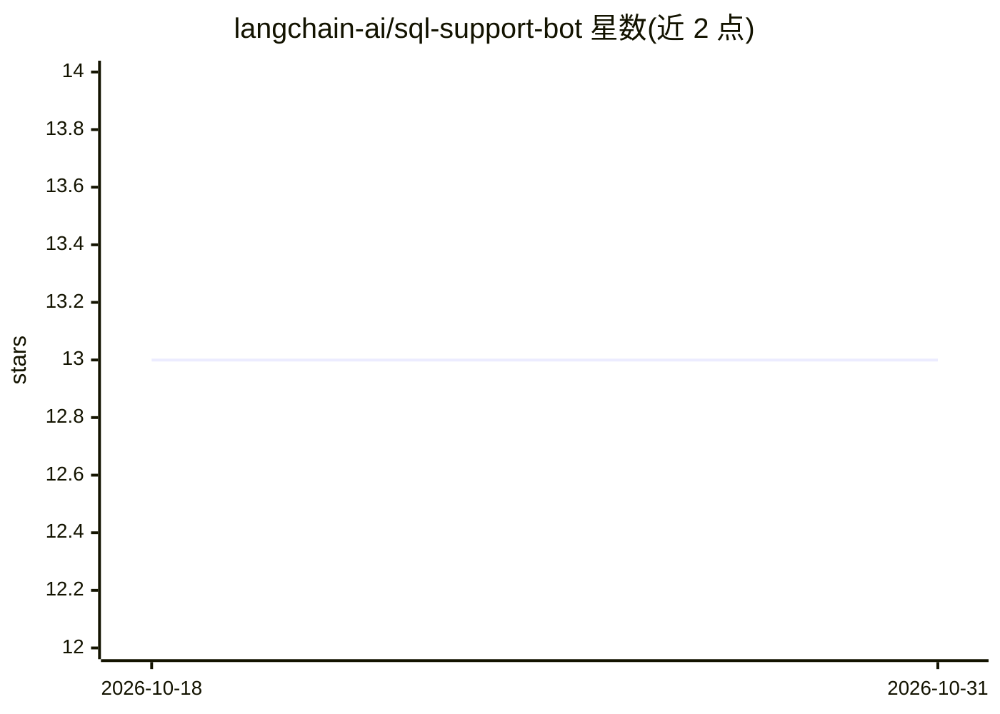

# langchain-ai/sql-support-bot

⭐ 13 · Jupyter Notebook · MIT · 推送 2026-10-23 · [GitHub](https://github.com/langchain-ai/sql-support-bot) · 组织维护

**基于 DeepAgents 的 SQL 数据库客服聊天机器人示例**

使用 DeepAgents 框架构建的客户支持聊天机器人，连接 Chinook 音乐商店 SQL 数据库，回答曲目、专辑、艺人与客户账户查询。Agent 依据查询自主决定调用 4 个工具（音乐搜索与客户信息查询）中的哪些；Chinook 数据库首次运行时自动下载。通过 uv 管理依赖，以 Python 脚本或 Jupyter Notebook 交互运行，需设置 OpenAI API key。README 末尾讨论了模糊输入鲁棒性与多步推理下工具调用正确性的评测方向。

## 筛选速览

| 维度 | 判定 | 备注 |
|---|---|---|
| AI 角色 | `ai-native` | 本体是模型或模型工具 |
| 许可风险 | `permissive` | MIT |
| 部署形态 | `None` |  |
| 模型依赖 | — | README 未给出锁定关系 |
| 硬件要求 | — | 无带数字的原话,不猜 |
| 安装摩擦 | `low` | 无编译、无系统依赖或容器化 |
| 成熟度 | — | 结构信号不足 |

## 能力要点

- DeepAgents 依据查询自主路由调用 4 个工具
- 连接 Chinook 数据库（首次运行自动下载）
- 提供 Python 脚本与 Jupyter Notebook 两种交互方式
- README 给出模糊输入与多步工具调用的评测编写方向

## 适用场景

- 查询音乐目录中的歌曲、专辑与艺人
- 查询客户账户信息（如客户邮箱）
- 作为 DeepAgents 构建 SQL 问答 Agent 的参考实现

## 场景标签

`聊天机器人` `数据分析` · 领域:效率与自动化

## 证据(README 行号)

> L3: Customer support chatbot built with DeepAgents that interacts with a SQL database (Chinook music store) to answer qu
> L11: The bot uses DeepAgents to autonomously decide which tools to use based on the customer's query.

## 星数曲线

2026-10-18 13 → 2026-10-31 13（+0）

---
*卡片 v1 · prompt 1.4 · 生成 2026-10-31 · 置信度 high · 依据 README sha `dc65c1ddfed0` · [字段定义](../../DATASET.md)*
