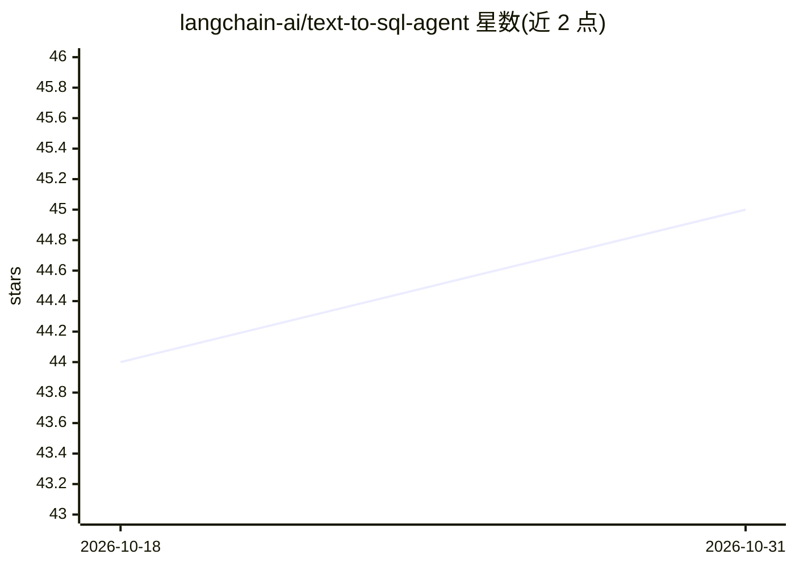

# langchain-ai/text-to-sql-agent

⭐ 45 · Jupyter Notebook · 推送 2026-10-23 · [GitHub](https://github.com/langchain-ai/text-to-sql-agent) · 个人维护

**自然语言查询数据库的 Text-to-SQL Agent 示例工程**

基于 LangChain 与 LangGraph 构建的自然语言转 SQL 查询 agent：以英文提问，agent 自动发现数据库表、读取相关表结构、用 Claude Sonnet 4.5 生成 SQL，经语法与安全校验后在数据库上执行，出错时自动改写重试，并格式化返回结果。演示数据库为 SQLite 版 Chinook，提供 CLI（agent.py）、Jupyter 教程 notebook 与 LangSmith 追踪集成。需 Python 3.11+、Anthropic API key，依赖以 pyproject.toml 声明，MIT 许可。

## 筛选速览

| 维度 | 判定 | 备注 |
|---|---|---|
| AI 角色 | `ai-native` | 本体是模型或模型工具 |
| 许可风险 | `none` | — |
| 部署形态 | `None` |  |
| 模型依赖 | locked-api |  |
| 硬件要求 | — | 无带数字的原话,不猜 |
| 安装摩擦 | `low` | 无编译、无系统依赖或容器化 |
| 成熟度 | — | 结构信号不足 |

## 能力要点

- 七步工作流：发现表→读 schema→生成 SQL→校验→执行→重试→格式化
- 自动查询校验与错误后自动改写重试
- LangSmith 集成：追踪执行轨迹、token 用量与重试记录
- 内置交互式 Jupyter 教程 notebook

## 适用场景

- 用自然语言查询数据库并获得 SQL 与结果
- 学习 LangChain create_agent 构建 agent 的流程
- 借助 LangSmith 观测与调试 SQL 生成过程

## 场景标签

`数据分析` `教程课程` · 领域:效率与自动化

## 证据(README 行号)

> L3: A natural language to SQL query agent powered by LangChain. Ask questions about your database in plain English and g
> L104: 3. **Generate** - Creates a SQL query using Claude Sonnet 4.5

## 星数曲线

2026-10-18 44 → 2026-10-31 45（+1）

---
*卡片 v1 · prompt 1.4 · 生成 2026-10-25 · 置信度 high · 依据 README sha `4a1df0975d62` · [字段定义](../../DATASET.md)*
