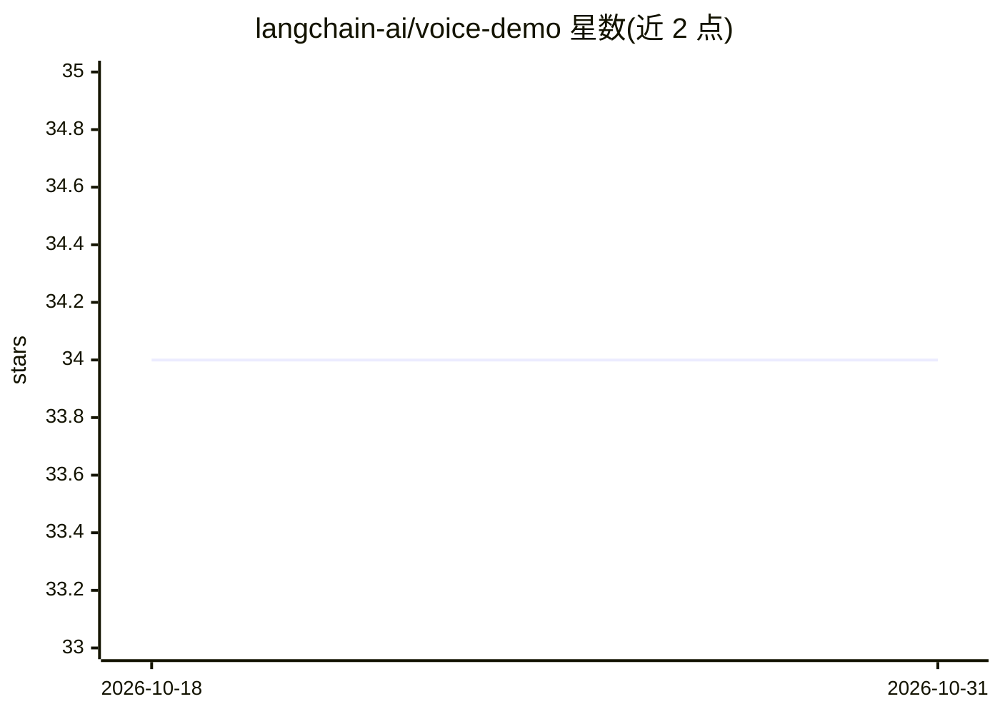

# langchain-ai/voice-demo

⭐ 34 · Python · 推送 2026-09-29 · [GitHub](https://github.com/langchain-ai/voice-demo) · 组织维护

**多框架语音 agent 后端示例集，统一接入 LangSmith 追踪**

langchain-ai 维护的演示仓库：用 12 个后端实现语音 agent，覆盖 OpenAI Realtime（原生 WebSocket 与 Agents SDK）、Gemini Live、Google ADK Live、LiveKit 与 Pipecat 级联（STT/LLM/TTS 可替换为 OpenAI Realtime 或 Gemini Live 做语音到语音）。所有后端共享一个控制台界面，通过 LangSmith SDK 的语音集成单行接入追踪。提供 CLI 运行、四个 workshop notebook；需 Python 3.11+ 与 uv，各后端自占独立文件夹。

## 筛选速览

| 维度 | 判定 | 备注 |
|---|---|---|
| AI 角色 | `ai-ecosystem` | LLM/agent 周边工具 |
| 许可风险 | `none` | — |
| 部署形态 | `None` |  |
| 模型依赖 | — | README 未给出锁定关系 |
| 硬件要求 | — | 无带数字的原话,不猜 |
| 安装摩擦 | `low` | 无编译、无系统依赖或容器化 |
| 成熟度 | — | 结构信号不足 |

## 能力要点

- 12 个语音 agent 后端实现，覆盖 OpenAI/Gemini/ADK/LiveKit/Pipecat 框架
- 统一控制台界面，经 AudioInput/AudioOutput/StatusUI 协议注入可替换
- 单行接入 LangSmith 语音集成，不改应用事件循环
- 每个后端独立自包含文件夹，附 4 个 workshop notebook

## 适用场景

- 学习在不同框架中搭建语音 agent 并接入 LangSmith 追踪
- 对比各语音框架的 STT/LLM/TTS 级联与语音到语音方案
- 作为自定义语音应用（Web/电话）的注入接口参考实现

## 场景标签

`语音 Agent` `教程课程` · 领域:对话与助手

## 证据(README 行号)

> L1: # Tracing Voice Agents to LangSmith - Demo Implementations
> L3: This repo implements a variety of voice agent backends across different frameworks, each instrumented for
> L4: LangSmith tracing using best practices.

## 星数曲线

2026-10-18 34 → 2026-10-31 34（+0）

---
*卡片 v1 · prompt 1.4 · 生成 2026-10-25 · 置信度 high · 依据 README sha `1c6fda4709cf` · [字段定义](../../DATASET.md)*
