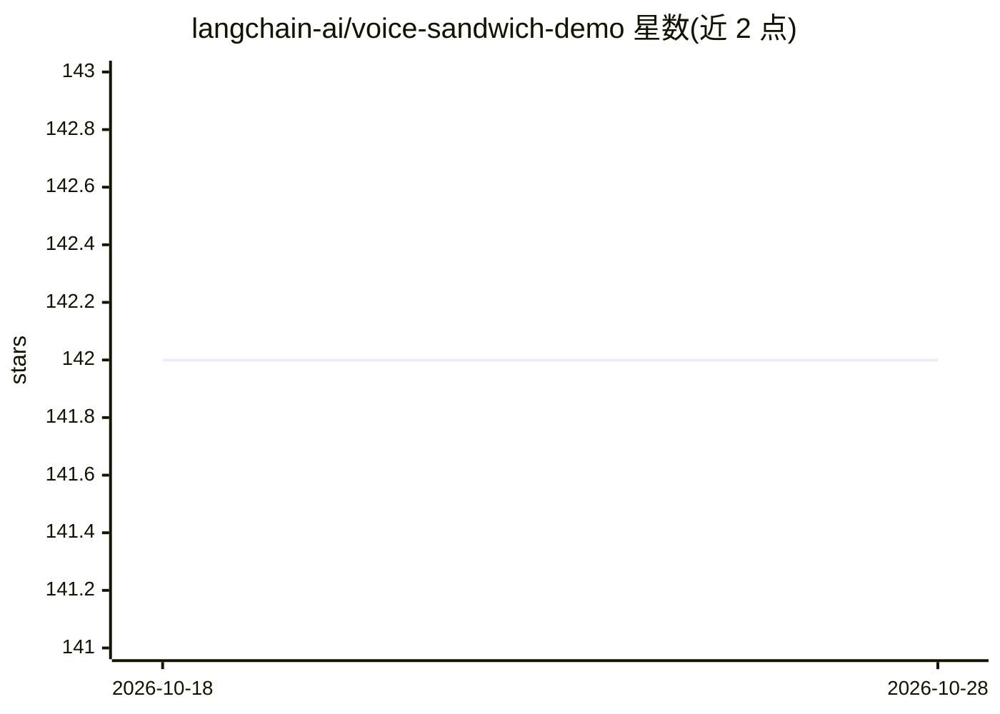

# langchain-ai/voice-sandwich-demo

⭐ 142 · TypeScript · 推送 2026-06-28 · [GitHub](https://github.com/langchain-ai/voice-sandwich-demo) · 组织维护

**实时语音到语音 AI 管线演示：三明治店点单助手**

基于 LangChain/LangGraph 的实时语音对话管线演示应用：浏览器麦克风 PCM 音频经 WebSocket 进入三级异步生成器流水线——AssemblyAI 流式语音转文本、LangChain 代理（Claude）处理文本并调用工具、Cartesia 文本转语音回传音频。以统一事件流（stt_chunk/agent_chunk/tts_chunk 等）在阶段间通信。提供 TypeScript 与 Python 两种后端实现，需自备三个服务的 API key。

## 筛选速览

| 维度 | 判定 | 备注 |
|---|---|---|
| AI 角色 | `ai-native` | 本体是模型或模型工具 |
| 许可风险 | `none` | — |
| 部署形态 | `library` | 以包/库形式分发 |
| 模型依赖 | locked-api |  |
| 硬件要求 | — | 无带数字的原话,不猜 |
| 安装摩擦 | `low` | 无编译、无系统依赖或容器化 |
| 成熟度 | — | 结构信号不足 |

## 能力要点

- STT→Agent→TTS 三级异步生成器流水线（producer-consumer 模式）
- 统一事件流协议，含实时部分转写与工具调用事件
- TypeScript 与 Python 双后端实现，共享 Svelte 前端

## 适用场景

- 参考搭建实时语音到语音的 AI 助手管线
- 学习异步生成器处理流式音频事件的方法
- 体验浏览器麦克风的语音点单对话

## 场景标签

`语音 Agent` · 领域:对话与助手

## 证据(README 行号)

> L3: A real-time, voice-to-voice AI pipeline demo featuring a sandwich shop order assistant. Built with LangChain/LangGra
> L20: 1. **STT Stage** (`sttStream`): Streams audio to AssemblyAI, yields transcription events (`stt_chunk`, `stt_output`
> L22: 3. **TTS Stage** (`ttsStream`): Passes upstream events through, sends agent text to Cartesia, yields audio events (

## 星数曲线

2026-10-18 142 → 2026-10-28 142（+0）

---
*卡片 v1 · prompt 1.4 · 生成 2026-10-22 · 置信度 high · 依据 README sha `1584e3d28bc7` · [字段定义](../../DATASET.md)*
