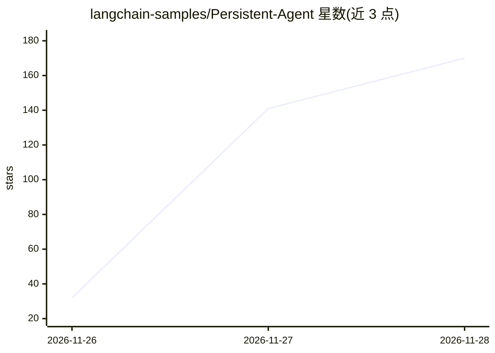

# langchain-samples/Persistent-Agent

⭐ 170 · Python · MIT · 推送 2026-11-25 · [GitHub](https://github.com/langchain-samples/Persistent-Agent) · 组织维护

**给团队部署常驻 Slack 的目标导向 agent 机器人**

基于 LangChain 的 Managed Deep Agents (MDA) 构建的常驻 agent，以单个 Slack 机器人形式部署给团队使用。提供每用户个人记忆、目标追踪、后台研究/审查子 agent、频道消息监听（仅在可提供帮助时发言）与夜间记忆整理任务；通过 LangSmith Tool Gateway（MCP）接入 Gmail、GitHub、Slack、Linear 等工具，并支持浏览器操作。部署依赖 LangSmith Plus/Enterprise 工作区、uv 及 Anthropic/OpenAI API key 或 LLM Gateway，通过 `uv run mda deploy` 部署到 LangSmith 托管环境。

## 筛选速览

| 维度 | 判定 | 备注 |
|---|---|---|
| AI 角色 | `ai-native` | 本体是模型或模型工具 |
| 许可风险 | `permissive` | MIT |
| 部署形态 | `None` |  |
| 模型依赖 | locked-api |  |
| 硬件要求 | — | 无带数字的原话,不猜 |
| 安装摩擦 | `low` | 无编译、无系统依赖或容器化 |
| 成熟度 | — | 结构信号不足 |

## 能力要点

- 每用户个人记忆、目标追踪与夜间记忆整理任务
- Watch mode 监听频道消息，仅在可提供帮助时发言
- 经 LangSmith Tool Gateway 接入 Gmail/GitHub/Slack/Linear 等内置 MCP 集成
- 后台异步运行研究与审查子 agent，支持自定义 Playbook

## 适用场景

- 给团队部署一个常驻 Slack 的助手机器人
- 让 agent 在后台执行研究与审查任务
- 把团队工作流程写成 Playbook 交给 agent 执行
- 让 agent 连接 Gmail/Linear/GitHub 等工具代为操作

## 场景标签

`工作流自动化` `聊天机器人` · 领域:效率与自动化

## 证据(README 行号)

> L9: Persistent Agent is a proactive, always-on, goal-oriented agent. Think Muse or Instinct, but
> L25: - **Integrations**: uses LangSmith Tool Gateway to access tools such as Gmail, GitHub, Slack, and Linear
> L82: uv run mda deploy

## 星数曲线

2026-11-26 32 → 2026-11-28 170（+138）

---
*卡片 v1 · prompt 1.4 · 生成 2026-11-26 · 置信度 high · 依据 README sha `7a43928e2dba` · [字段定义](../../DATASET.md)*
