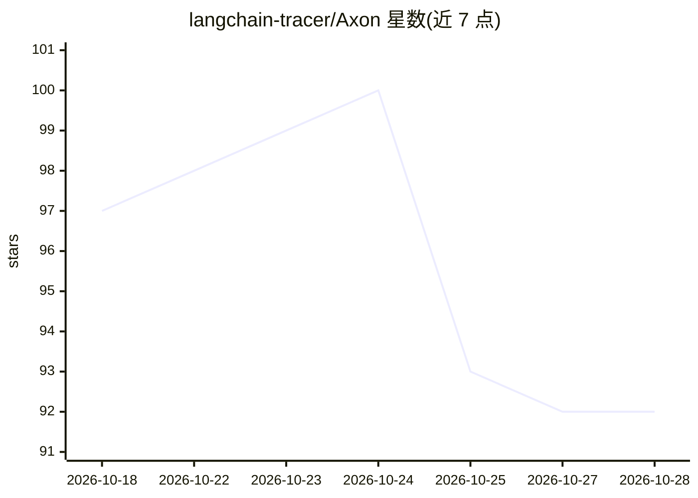

# langchain-tracer/Axon

⭐ 93 · TypeScript · MIT · 推送 2026-08-06 · [GitHub](https://github.com/langchain-tracer/Axon) · [官网](https://www.npmjs.com/package/@axon-ai/cli) · 组织维护

**本地 LLM/agent 链路追踪观测工具，OTLP 接收+实时仪表盘**

面向 LangChain 与 OpenTelemetry 插桩 AI 应用的本地可观测性 CLI：接收应用发送的 OTLP 追踪数据，存入项目目录下的 SQLite 数据库，并通过 React 仪表盘实时展示每次 LLM 调用、工具调用与链执行。提供 Transcript/Waterfall/Tree/Raw 四种追踪视图。以 npm 包 @axon-ai/cli 分发（捆绑后端与仪表盘），也支持 Docker 全栈运行；Node.js 侧配 @axon-ai/langchain-tracer，Python 侧可配 OpenLLMetry 接入。数据不离开本机，无需云账号。

## 筛选速览

| 维度 | 判定 | 备注 |
|---|---|---|
| AI 角色 | `ai-ecosystem` | LLM/agent 周边工具 |
| 许可风险 | `permissive` | MIT |
| 部署形态 | `library` | 以包/库形式分发 |
| 模型依赖 | — | README 未给出锁定关系 |
| 硬件要求 | — | 无带数字的原话,不猜 |
| 安装摩擦 | `low` | 无编译、无系统依赖或容器化 |
| 成熟度 | — | 结构信号不足 |

## 能力要点

- 接收任意 OTLP exporter 的追踪数据，本地 SQLite 存储
- 实时仪表盘：Transcript/Waterfall/Tree/Raw 四种视图
- CLI 一条命令启动后端与仪表盘，无需云账号
- 提供 Docker 全栈运行方式

## 适用场景

- 本地调试 LangChain/agent 的 LLM 调用与工具执行链路
- 不想把追踪数据上传云端时在本机观测 agent 行为
- 通过瀑布图/树状图定位 agent 执行中的耗时环节

## 场景标签

`LLM 可观测性` · 领域:评测与运维

## 证据(README 行号)

> L5: Axon is a local observability tool for LangChain and OpenTelemetry-instrumented AI agents. It receives trace data fr
> L28: Axon runs entirely on your machine. When you start it, a single server comes up that handles two responsibilities: 

## 星数曲线

2026-10-18 97 → 2026-10-28 92（-5）

---
*卡片 v1 · prompt 1.4 · 生成 2026-10-23 · 置信度 mid · 依据 README sha `74ed9106bbd9` · [字段定义](../../DATASET.md)*
