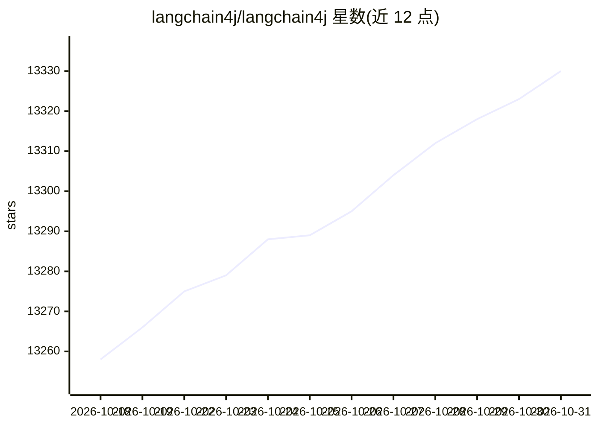

# langchain4j/langchain4j

⭐ 13,330 · Java · Apache-2.0 · 推送 2026-10-30 · [GitHub](https://github.com/langchain4j/langchain4j) · [官网](https://docs.langchain4j.dev) · 组织维护

**给 JVM/Java 开发者的 LLM 应用开发库**

LangChain4j 是一个面向 JVM 的开源 Java 库，目标是简化在 Java 应用中集成 LLM 的过程。它提供统一 API 屏蔽各 LLM 提供商与向量数据库的专有接口，支持在 20+ LLM 提供商与 30+ 嵌入存储之间切换而无需重写代码。工具箱覆盖提示词模板、聊天记忆管理、函数调用，直至 Agents 与 RAG 等高层模式，每个抽象都带接口与多种实现。该库按 Java 惯例从零设计（类型安全、POJO、注解、依赖注入），与 Quarkus、Spring Boot、Helidon、Micronaut 一级集成，与 Python 版 LangChain 的 API 与发布周期相互独立。

## 筛选速览

| 维度 | 判定 | 备注 |
|---|---|---|
| AI 角色 | `ai-native` | 本体是模型或模型工具 |
| 许可风险 | `permissive` | Apache-2.0 |
| 部署形态 | `None` |  |
| 模型依赖 | — | README 未给出锁定关系 |
| 硬件要求 | — | 无带数字的原话,不猜 |
| 安装摩擦 | `low` | 无编译、无系统依赖或容器化 |
| 成熟度 | `idea` | |

## 动量与使用信号

- 维护:`active` — 距上次 push 1.7 天,年发版 37,445 位贡献者
- 涨星:近 1 天 **+5**(自 20261016 起算)

## 能力要点

- 统一 API 覆盖 20+ LLM 提供商与 30+ 嵌入存储，可切换实现
- 工具箱从提示词模板、聊天记忆、函数调用到 Agents 与 RAG
- 按 Java 惯例原生设计，一级集成 Quarkus/Spring Boot/Helidon/Micronaut
- MCP 相关工具调用支持

## 适用场景

- 在 Spring Boot/Quarkus 等 Java 企业应用中接入 LLM
- 构建从数据摄取到检索的完整 RAG 管线
- 开发带工具调用的聊天机器人或 Agent
- 在不重写代码的前提下试验和更换不同 LLM 提供商

## 场景标签

`Agent 框架` `RAG` `模型网关` · 领域:Agent 开发

## 证据(README 行号)

> L16: The goal of LangChain4j is to simplify integrating LLMs into Java applications.
> L23:  LangChain4j currently supports 20+ popular LLM providers
> L43: type safety, POJOs, annotations, interfaces, dependency injection, fluent APIs, and first-class integrations with Q

## 星数曲线

2026-10-18 13,258 → 2026-10-31 13,330（+72）

---
*卡片 v1 · prompt 1.4 · 生成 2026-10-18 · 置信度 high · 依据 README sha `dad933cbf1db` · [字段定义](../../DATASET.md)*
