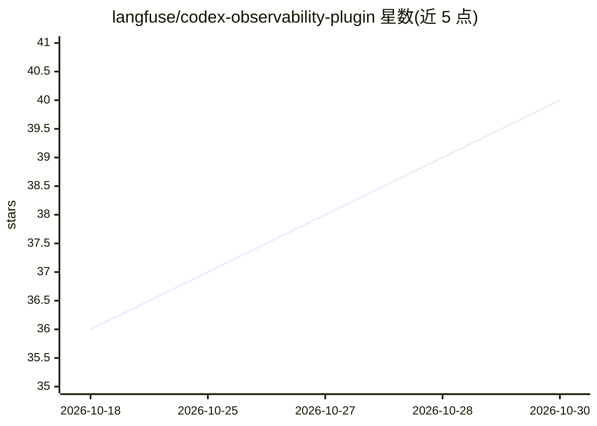

# langfuse/codex-observability-plugin

⭐ 40 · TypeScript · MIT · 推送 2026-10-28 · [GitHub](https://github.com/langfuse/codex-observability-plugin) · [官网](https://langfuse.com/integrations/developer-tools/codex) · 组织维护

**将 OpenAI Codex CLI 会话遥测发送到 Langfuse 的插件**

Codex CLI 插件：追踪 agent 轮次、模型生成、推理摘要、系统提示、工具调用、图像、子 agent 线程、技能调用与 token 用量，并上传到 Langfuse（云端或 3.95.0 及以上自托管版）。需 Codex 0.143+、Node.js 22+ 及 npm CLI。凭据经 langfuse.json 或环境变量配置，默认关闭需显式开启；安装后须在 Codex 中信任 Stop hook 才会上传，插件更新后可能需重新审查。上传内容包括提示与工具输入输出。

## 筛选速览

| 维度 | 判定 | 备注 |
|---|---|---|
| AI 角色 | `ai-ecosystem` | LLM/agent 周边工具 |
| 许可风险 | `permissive` | MIT |
| 部署形态 | `None` |  |
| 模型依赖 | — | README 未给出锁定关系 |
| 硬件要求 | — | 无带数字的原话,不猜 |
| 安装摩擦 | `low` | 无编译、无系统依赖或容器化 |
| 成熟度 | — | 结构信号不足 |

## 能力要点

- 追踪 agent 轮次、工具调用、子 agent 线程与 token 用量
- 支持 Langfuse Cloud 多区域（EU/US/JP/HIPAA）及自托管
- 凭据支持 langfuse.json 与环境变量，环境变量优先且可用 LANGFUSE_CODEX_* 限定作用域
- trace_seed 可派生确定性 trace id，便于 headless 调用方预知

## 适用场景

- 在 Langfuse 中观察我的 Codex CLI 编码会话与 agent 行为
- 按环境/用户/标签归档并检索 Codex 会话追踪
- 为自动化 Codex 运行预知 trace id 以便关联

## 场景标签

`LLM 可观测性` · 领域:评测与运维

## 证据(README 行号)

> L3: Codex plugin that sends OpenAI Codex session telemetry to Langfuse. It traces agent turns, model generations, reason
> L29: - Codex `0.143` and newer

## 星数曲线

2026-10-18 36 → 2026-10-30 40（+4）

---
*卡片 v1 · prompt 1.4 · 生成 2026-10-25 · 置信度 high · 依据 README sha `4e7a40455be6` · [字段定义](../../DATASET.md)*
