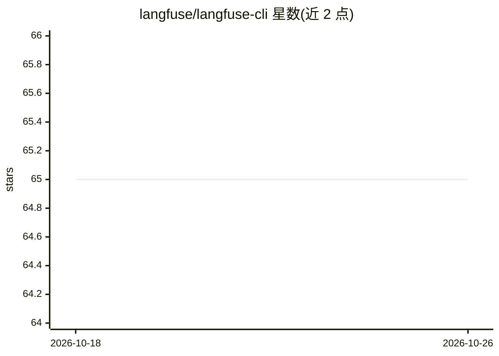

# langfuse/langfuse-cli

⭐ 65 · TypeScript · MIT · 推送 2026-10-21 · [GitHub](https://github.com/langfuse/langfuse-cli) · [官网](https://langfuse.com/docs/api-and-data-platform/features/cli) · 组织维护

**Langfuse API 的命令行客户端，面向 AI agent 与高级用户**

通过命令行调用 Langfuse API 的 CLI 工具，支持资源发现（api help）、prompts/scores 等资源的增删查，请求体支持 --body-json/--body-file 与自动生成的 kebab-case 字段参数，带判别器的 union 请求体可直接用字段参数。通过环境变量或 .env 提供 public/secret key 认证，默认指向 Langfuse Cloud。定义 0-6 的退出码便于 agent 判断调用结果，并提供 get-skill 命令拉取最新 Langfuse skill 供注入 agent 上下文。以 npx/bun/npm 方式分发。

## 筛选速览

| 维度 | 判定 | 备注 |
|---|---|---|
| AI 角色 | `ai-ecosystem` | LLM/agent 周边工具 |
| 许可风险 | `permissive` | MIT |
| 部署形态 | `library` | 以包/库形式分发 |
| 模型依赖 | — | README 未给出锁定关系 |
| 硬件要求 | — | 无带数字的原话,不猜 |
| 安装摩擦 | `low` | 无编译、无系统依赖或容器化 |
| 成熟度 | — | 结构信号不足 |

## 能力要点

- 命令行覆盖 Langfuse API 全部资源与操作，含 help 资源发现
- --body-json/--body-file 与自动生成的 kebab-case 参数提供无损输入路径
- 0-6 退出码约定，便于 agent 程序化判断调用结果
- get-skill 从 GitHub 拉取最新 Langfuse skill 可注入系统提示词

## 适用场景

- 在脚本或 CI 中直接调用 Langfuse API 管理 prompts、scores 等资源
- 让 AI agent 通过 CLI 操作 Langfuse 并依据退出码处理结果
- 无需写代码快速调试 Langfuse API 请求

## 场景标签

`LLM 可观测性` `提示工程` · 领域:Agent 开发

## 证据(README 行号)

> L5: Interact with the Langfuse API from the command line.
> L27: LANGFUSE_HOST=https://cloud.langfuse.com  # optional, this is the default (LANGFUSE_BASE_URL also supported)

## 星数曲线

2026-10-18 65 → 2026-10-26 65（+0）

---
*卡片 v1 · prompt 1.4 · 生成 2026-10-24 · 置信度 high · 依据 README sha `aabee34902be` · [字段定义](../../DATASET.md)*
