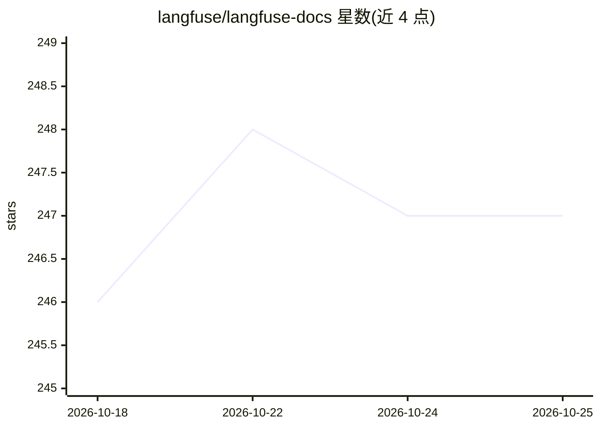

# langfuse/langfuse-docs

⭐ 247 · MDX · MIT · 推送 2026-10-25 · [GitHub](https://github.com/langfuse/langfuse-docs) · [官网](https://langfuse.com/docs) · 组织维护

**Langfuse 平台的文档站仓库，含面向 LLM 的文档特性**

Langfuse（开源 agent 评测与可观测平台）的官方文档站点仓库，基于 Fumadocs 与 Next.js App Router 构建，面向参与文档贡献的开发者。本地开发需 Node.js 22（22.13+）与 pnpm。仓库包含 Python/Deno Jupyter cookbook（经 nbconvert 转为 markdown 渲染），并提供四项面向 LLM/AI 工具的文档特性：URL 加 .md 后缀获取原始 markdown、页面上“复制为 Markdown”按钮、PDF 导出端点，以及提供 searchLangfuseDocs 等三个工具的 MCP Server。

## 筛选速览

| 维度 | 判定 | 备注 |
|---|---|---|
| AI 角色 | `ai-ecosystem` | LLM/agent 周边工具 |
| 许可风险 | `permissive` | MIT |
| 部署形态 | `library` | 以包/库形式分发 |
| 模型依赖 | — | README 未给出锁定关系 |
| 硬件要求 | — | 无带数字的原话,不猜 |
| 安装摩擦 | `low` | 无编译、无系统依赖或容器化 |
| 成熟度 | — | 结构信号不足 |

## 能力要点

- 任意文档 URL 加 .md 后缀可获取编译期生成的静态 markdown
- 内置 MCP Server（/api/mcp），提供 RAG 搜索、取页面、llms.txt 概览三个工具
- Jupyter cookbook 经脚本自动转为文档页，禁止手改生成文件
- 使用 Inkeep 提供站内搜索与 Ask AI 聊天

## 适用场景

- 为 Langfuse 平台撰写或修改文档
- 让 AI 编程助手通过 MCP 或 markdown 端点读取 Langfuse 文档
- 浏览 Langfuse 的示例 cookbook

## 场景标签

 · 领域:LLM 工具平台文档

## 证据(README 行号)

> L5: Repo for langfuse.com. Built with Fumadocs and Next.js App Router.
> L86: 4. **MCP Server**: Model Context Protocol server at `/api/mcp` with three tools:

## 星数曲线

2026-10-18 246 → 2026-10-25 247（+1）

---
*卡片 v1 · prompt 1.4 · 生成 2026-10-22 · 置信度 high · 依据 README sha `3e7e8c9aa5bb` · [字段定义](../../DATASET.md)*
