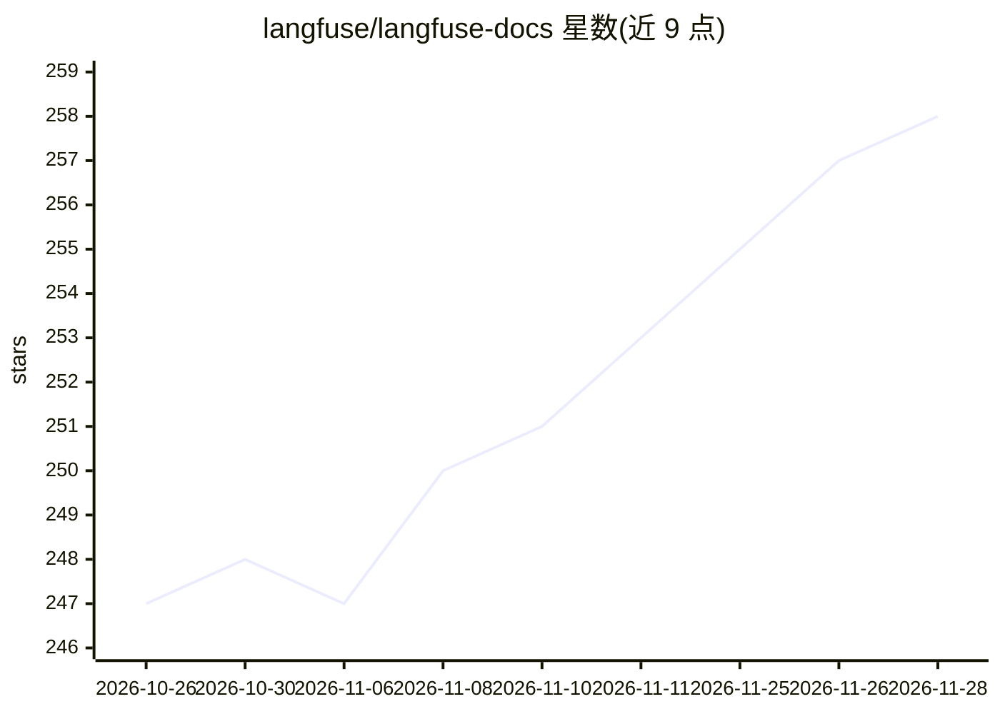

# langfuse/langfuse-docs

⭐ 258 · MDX · MIT · 推送 2026-11-27 · [GitHub](https://github.com/langfuse/langfuse-docs) · [官网](https://langfuse.com/docs) · 组织维护

**Langfuse 官方文档站的源码仓库，含 LLM 应用可读文档与 MCP 接口**

该仓库存放 langfuse.com 文档站源码，使用 Fumadocs 与 Next.js App Router 构建。README 内容以文档站维护为主：本地开发流程（Node.js 24 + pnpm）、Prettier 格式化、Jupyter cookbook 渲染管线、媒体资源管理。面向 LLM 与 AI 工具的可访问性机制包括：任意 URL 加 .md 后缀获取原始 Markdown、页面上的 Copy as Markdown 按钮，以及在 /api/mcp 提供 MCP Server（含文档 RAG 搜索、页面抓取、概览三个工具）。

## 筛选速览

| 维度 | 判定 | 备注 |
|---|---|---|
| AI 角色 | `ai-knowledge` | 知识聚合/清单类 |
| 许可风险 | `permissive` | MIT |
| 部署形态 | `library` | 以包/库形式分发 |
| 模型依赖 | — | README 未给出锁定关系 |
| 硬件要求 | — | 无带数字的原话,不猜 |
| 安装摩擦 | `low` | 无编译、无系统依赖或容器化 |
| 成熟度 | — | 结构信号不足 |

## 能力要点

- 任意文档 URL 追加 .md 获取静态 Markdown 文件
- 提供 MCP Server（/api/mcp），含搜索/取页/概览三个工具
- Jupyter cookbook 经 nbconvert 自动渲染为文档页
- 集成 Inkeep 的搜索与 Ask AI 聊天组件

## 适用场景

- 为 Langfuse 文档站做本地开发与内容贡献
- 通过 MCP Server 让 AI 工具检索 Langfuse 文档
- 把文档页面复制为 Markdown 粘贴到 LLM 工具中使用

## 场景标签

 · 领域:开发者文档/LLM 基础设施文档

## 证据(README 行号)

> L3: # Langfuse Docs
> L78: The docs site includes three interconnected features designed to make documentation accessible to LLMs and AI tools
> L84: 3. **MCP Server**: Model Context Protocol server at `/api/mcp` with three tools:

## 星数曲线

2026-10-26 247 → 2026-11-28 258（+11）

---
*卡片 v1 · prompt 1.4 · 生成 2026-11-25 · 置信度 high · 依据 README sha `df042629af3e` · [字段定义](../../DATASET.md)*
