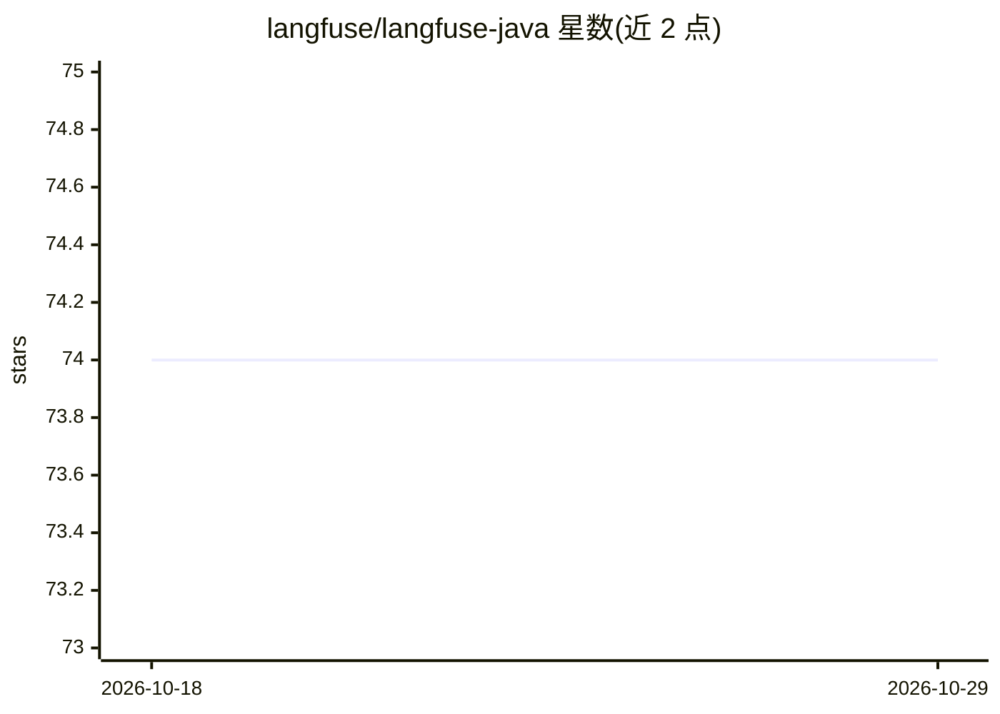

# langfuse/langfuse-java

⭐ 74 · Java · MIT · 推送 2026-10-23 · [GitHub](https://github.com/langfuse/langfuse-java) · 组织维护

**面向 Java 开发者的 Langfuse API 自动生成客户端**

基于 Langfuse API 规范自动生成的 Java 客户端库，通过 Maven Central 以 com.langfuse:langfuse-java 发布。覆盖 Langfuse 平台的 prompts、datasets、scores、models、comments、annotation queues 及读取类 API；追踪数据摄入不再走本客户端的 legacy ingestion API（已弃用并将在 Langfuse v4 移除），改为推荐通过 OpenTelemetry Java SDK 经 OTLP/HTTP 导出 span 到 Langfuse 端点。提供同步与异步两种客户端构建方式，仓库含单元测试与需凭证的集成测试，并使用 fern 生成器维护代码。给需要在 Java 应用中接入 Langfuse LLM 可观测平台的开发者使用。

## 筛选速览

| 维度 | 判定 | 备注 |
|---|---|---|
| AI 角色 | `ai-ecosystem` | LLM/agent 周边工具 |
| 许可风险 | `permissive` | MIT |
| 部署形态 | `library` | 以包/库形式分发 |
| 模型依赖 | — | README 未给出锁定关系 |
| 硬件要求 | — | 无带数字的原话,不猜 |
| 安装摩擦 | `low` | 无编译、无系统依赖或容器化 |
| 成熟度 | — | 结构信号不足 |

## 能力要点

- 从 Langfuse API 规范自动生成，同步与异步客户端均可用
- 覆盖 prompts、datasets、scores、models、comments、annotation queues 等非追踪类 API
- 追踪数据摄入走 OpenTelemetry OTLP/HTTP，由平台侧处理批处理与重试
- 已预先移除 v3 模型的弃用端点，仅保留 v4 兼容的 API 表面

## 适用场景

- 在 Java 应用中读取和管理 Langfuse 的 prompts 与 datasets
- 向 Langfuse 写入或查询 LLM 应用的 scores 评分数据
- 配合 OpenTelemetry SDK 将 Java 应用的追踪数据发送到 Langfuse

## 场景标签

`LLM 可观测性` `提示工程` · 领域:Agent 开发

## 证据(README 行号)

> L3: This repository contains an auto-generated Langfuse API client for Java based on our API specification.
> L22: Use this client for everything that is *not* tracing ingestion: prompts, datasets, scores, models, comments, annota

## 星数曲线

2026-10-18 74 → 2026-10-29 74（+0）

---
*卡片 v1 · prompt 1.4 · 生成 2026-10-24 · 置信度 mid · 依据 README sha `a6e6643f7fe8` · [字段定义](../../DATASET.md)*
