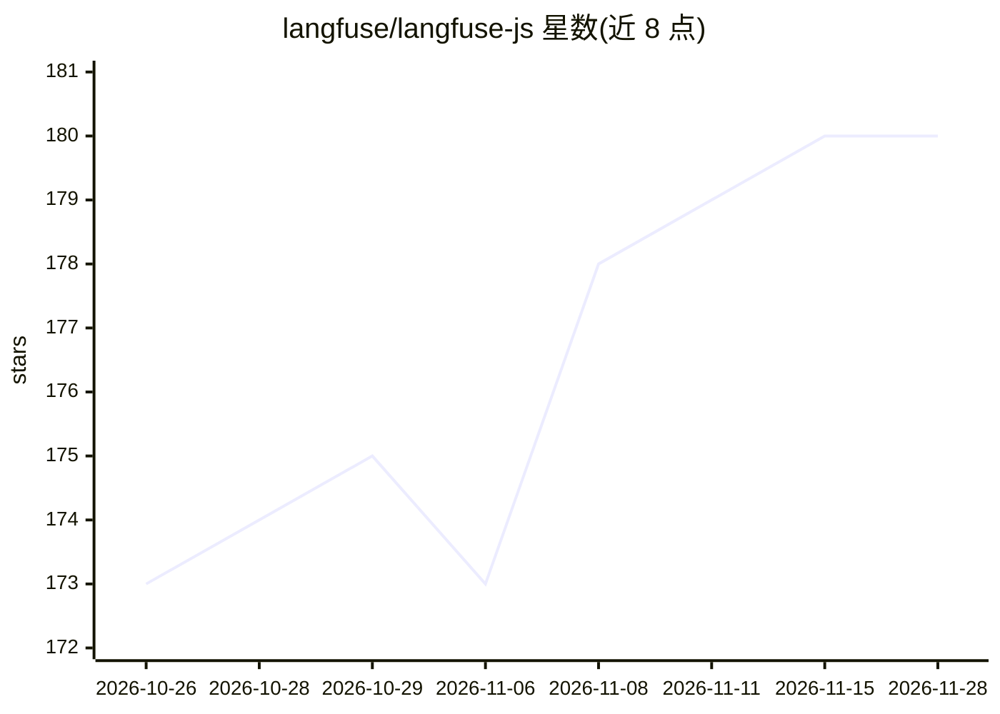

# langfuse/langfuse-js

⭐ 180 · TypeScript · MIT · 推送 2026-11-27 · [GitHub](https://github.com/langfuse/langfuse-js) · [官网](https://langfuse.com/docs/observability/sdk/overview) · 组织维护

**面向 JS/TS 开发者的 Langfuse 可观测性 SDK 单仓库**

Langfuse JS/TS 客户端库的 monorepo，包含 7 个包：通用 API 客户端、浏览器公钥打分 SDK、基于 OpenTelemetry 的埋点与导出包，以及 OpenAI SDK、LangChain、Vercel AI SDK 的集成包。v6 为当前主版本，需 Node.js 22+，并要求 Langfuse Cloud 或 v4.59.0+ 的自托管服务端；无作用域的旧包（langfuse 等）为已废弃的 v3 客户端。实时数据路径仅限 OpenTelemetry 摄取配合 Observations API v2，其余 GET API 可延迟达 10 分钟。

## 筛选速览

| 维度 | 判定 | 备注 |
|---|---|---|
| AI 角色 | `ai-ecosystem` | LLM/agent 周边工具 |
| 许可风险 | `permissive` | MIT |
| 部署形态 | `library` | 以包/库形式分发 |
| 模型依赖 | — | README 未给出锁定关系 |
| 硬件要求 | — | 无带数字的原话,不猜 |
| 安装摩擦 | `low` | 无编译、无系统依赖或容器化 |
| 成熟度 | — | 结构信号不足 |

## 能力要点

- 7 个包覆盖通用客户端、浏览器打分与 OpenTelemetry 埋点导出
- 提供 OpenAI SDK、LangChain、Vercel AI SDK 三种框架集成包
- 实时路径基于 OTel 摄取 + Observations API v2 / Metrics API v2
- v5→v6 提供迁移指南，明确废弃 v3 无作用域包

## 适用场景

- 为 LLM 应用接入 Langfuse 追踪与打分
- 在浏览器端用公钥上传用户打分
- 将 LangChain 或 Vercel AI SDK 的调用链路导出到 Langfuse

## 场景标签

`LLM 可观测性` · 领域:评测与运维

## 证据(README 行号)

> L11: Modular mono repo for the Langfuse JS/TS client libraries.
> L30: |@langfuse/client|NPM|Langfuse API client for universal JavaScript environments|Universal JS|

## 星数曲线

2026-10-26 173 → 2026-11-28 180（+7）

---
*卡片 v1 · prompt 1.4 · 生成 2026-11-27 · 置信度 high · 依据 README sha `13d5ccd0afa6` · [字段定义](../../DATASET.md)*
