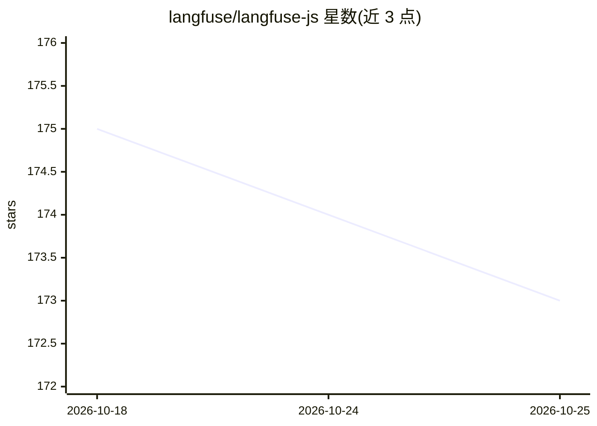

# langfuse/langfuse-js

⭐ 173 · TypeScript · MIT · 推送 2026-10-25 · [GitHub](https://github.com/langfuse/langfuse-js) · [官网](https://langfuse.com/docs/observability/sdk/overview) · 组织维护

**Langfuse 官方 JS/TS SDK 集合：LLM 应用的可观测性接入**

Langfuse 的 JS/TS 客户端库 monorepo，含 7 个 npm 包：通用 API 客户端（client）、浏览器分数采集（browser）、基于 OpenTelemetry 的插桩（tracing/otel），以及 OpenAI、LangChain、Vercel AI SDK 集成包。v5 版本重写后推荐安装 @langfuse/tracing 等作用域包，旧的非作用域包（langfuse 等）已声明废弃；v6 要求 Langfuse Cloud 或自托管 v4.59.0+ 服务端。面向在 JS/TS 项目中接入 Langfuse 可观测性的开发者，MIT 许可。

## 筛选速览

| 维度 | 判定 | 备注 |
|---|---|---|
| AI 角色 | `ai-ecosystem` | LLM/agent 周边工具 |
| 许可风险 | `none` | MIT |
| 部署形态 | `library` | 以包/库形式分发 |
| 模型依赖 | — | README 未给出锁定关系 |
| 硬件要求 | — | 无带数字的原话,不猜 |
| 安装摩擦 | `low` | 无编译、无系统依赖或容器化 |
| 成熟度 | — | 结构信号不足 |

## 能力要点

- 7 个 npm 包覆盖 API 客户端、浏览器采集、OpenTelemetry 插桩
- 提供 OpenAI / LangChain / Vercel AI SDK 官方集成包
- v5 重写，基于 OpenTelemetry 的实时数据摄入路径

## 适用场景

- 在 Node.js 应用中对 LLM 调用做插桩并上报 Langfuse
- 在浏览器端通过公钥上报用户评分
- 查询 Langfuse 的 Observations API v2 数据

## 场景标签

`LLM 可观测性` · 领域:评测与运维

## 证据(README 行号)

> L11: Modular mono repo for the Langfuse JS/TS client libraries.
> L32: |@langfuse/tracing|NPM|Langfuse instrumentation methods based on OpenTelemetry|Node.js 22+|
> L34: |@langfuse/openai|NPM|Langfuse integration for OpenAI SDK|Universal JS|

## 星数曲线

2026-10-18 175 → 2026-10-25 173（-2）

---
*卡片 v1 · prompt 1.4 · 生成 2026-10-22 · 置信度 high · 依据 README sha `0e6cd90e50a0` · [字段定义](../../DATASET.md)*
