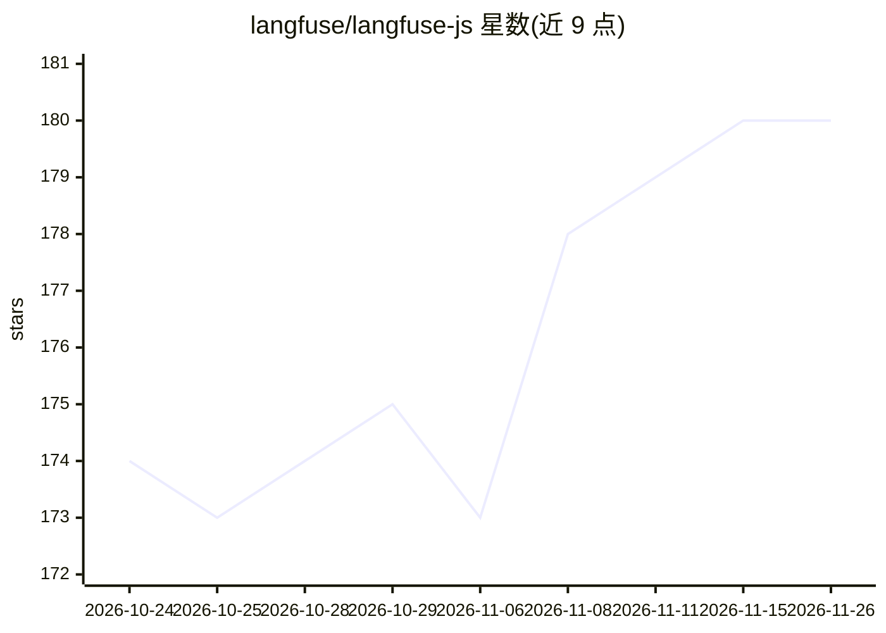

# langfuse/langfuse-js

⭐ 180 · TypeScript · MIT · 推送 2026-11-25 · [GitHub](https://github.com/langfuse/langfuse-js) · [官网](https://langfuse.com/docs/observability/sdk/overview) · 组织维护

**面向 JS/TS 开发者的 Langfuse LLM 可观测性 SDK**

Langfuse JS/TS 客户端库的单仓多包仓库，v5 起重写并基于 OpenTelemetry：@langfuse/tracing 提供观测埋点方法，@langfuse/otel 提供导出助手，@langfuse/client 提供通用 JS API 客户端，@langfuse/browser 提供浏览器端公钥打分上报；另提供 OpenAI SDK、LangChain、Vercel AI SDK 的集成包。注意旧版非 scope 包（langfuse 等）已弃用，v6 需 Langfuse v4.59.0 以上服务端，多数 GET API 数据有最长 10 分钟延迟。

## 筛选速览

| 维度 | 判定 | 备注 |
|---|---|---|
| AI 角色 | `ai-ecosystem` | LLM/agent 周边工具 |
| 许可风险 | `permissive` | MIT |
| 部署形态 | `library` | 以包/库形式分发 |
| 模型依赖 | — | README 未给出锁定关系 |
| 硬件要求 | — | 无带数字的原话,不猜 |
| 安装摩擦 | `low` | 无编译、无系统依赖或容器化 |
| 成熟度 | — | 结构信号不足 |

## 能力要点

- 基于 OpenTelemetry 的埋点与导出（@langfuse/tracing、@langfuse/otel）
- 多环境包划分：通用 JS、浏览器、Node.js 22+
- 提供 OpenAI SDK / LangChain / Vercel AI SDK 集成包
- pnpm 管理的 monorepo，含构建与 CI 测试脚本

## 适用场景

- 为 LLM 应用接入 Langfuse 追踪与观测
- 浏览器端以公钥上报用户打分
- 通过 OpenAI SDK 或 LangChain 集成自动埋点
- 自托管 Langfuse 服务端的客户端升级改造

## 场景标签

`LLM 可观测性` · 领域:评测与运维

## 证据(README 行号)

> L11: Modular mono repo for the Langfuse JS/TS client libraries.
> L20: > **Latest install:** `npm install @langfuse/tracing @langfuse/otel "@opentelemetry/sdk-node@<0.300"` (OpenTelemetr

## 星数曲线

2026-10-24 174 → 2026-11-26 180（+6）

---
*卡片 v1 · prompt 1.4 · 生成 2026-11-26 · 置信度 high · 依据 README sha `a3995397f4e0` · [字段定义](../../DATASET.md)*
