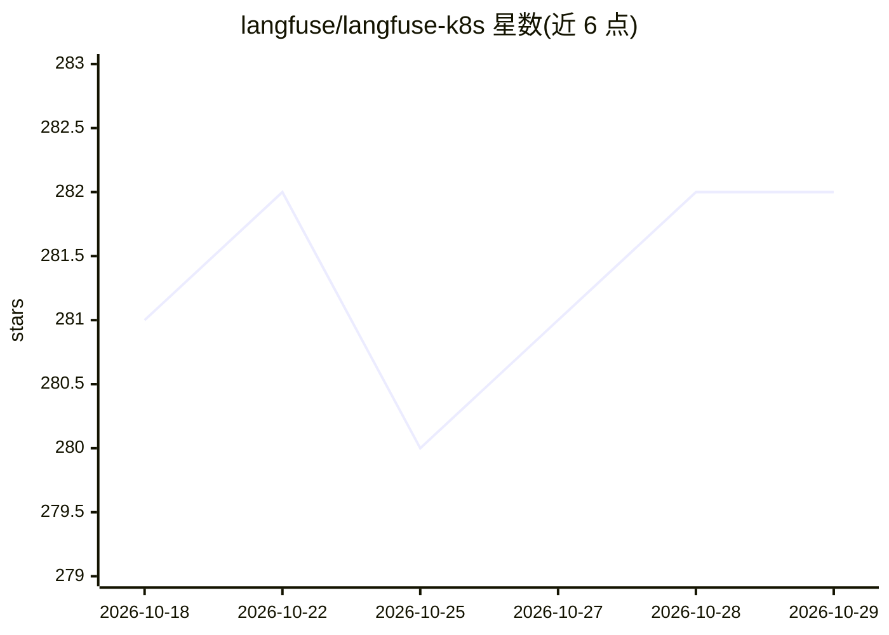

# langfuse/langfuse-k8s

⭐ 282 · Go Template · MIT · 推送 2026-10-28 · [GitHub](https://github.com/langfuse/langfuse-k8s) · [官网](https://langfuse.com/self-hosting/deployment/kubernetes-helm) · 组织维护

**社区维护的 Langfuse Kubernetes 部署 Helm chart**

提供在 Kubernetes 上部署 Langfuse（LLM 可观测平台）的 Helm chart 与示例 yaml 配置：默认捆绑部署 Postgres、ClickHouse（经 ClickHouse operator）、Valkey、SeaweedFS 子组件，首次安装自动生成并持久化全部凭据 Secret；支持外接数据库、S3/Azure/GCS 存储、Redis Cluster、ingress 与自定义存储类等配置。v2.0.0 以 OSS 许可子 chart 替换 Bitnami 组件，并内置 v1→v2 升级防护。面向自托管 Langfuse 的运维/开发人员。

## 筛选速览

| 维度 | 判定 | 备注 |
|---|---|---|
| AI 角色 | `ai-ecosystem` | LLM/agent 周边工具 |
| 许可风险 | `permissive` | MIT |
| 部署形态 | `library` | 以包/库形式分发 |
| 模型依赖 | — | README 未给出锁定关系 |
| 硬件要求 | — | 无带数字的原话,不猜 |
| 安装摩擦 | `low` | 无编译、无系统依赖或容器化 |
| 成熟度 | — | 结构信号不足 |

## 能力要点

- Helm chart 一键部署 Langfuse 及关联数据库组件
- 首次安装自动生成凭据 Secret 并跨升级持久化
- 支持外接 Postgres/ClickHouse/S3/Azure/GCS/Redis Cluster
- v2.0.0 以 OSS 子 chart 替换 Bitnami 并提供 v1→v2 迁移路径

## 适用场景

- 在 Kubernetes 集群上自托管 Langfuse
- 从 Bitnami 版 chart 迁移到 v2 OSS 组件
- 生产环境外接数据库与对象存储的部署配置

## 场景标签

`LLM 可观测性` · 领域:评测与运维

## 证据(README 行号)

> L7: This is a community-maintained repository that contains resources for deploying Langfuse on Kubernetes.
> L53: We provide a Helm chart that helps you deploy Langfuse on Kubernetes.

## 星数曲线

2026-10-18 281 → 2026-10-29 282（+1）

---
*卡片 v1 · prompt 1.4 · 生成 2026-10-22 · 置信度 high · 依据 README sha `1e5a7b13204d` · [字段定义](../../DATASET.md)*
