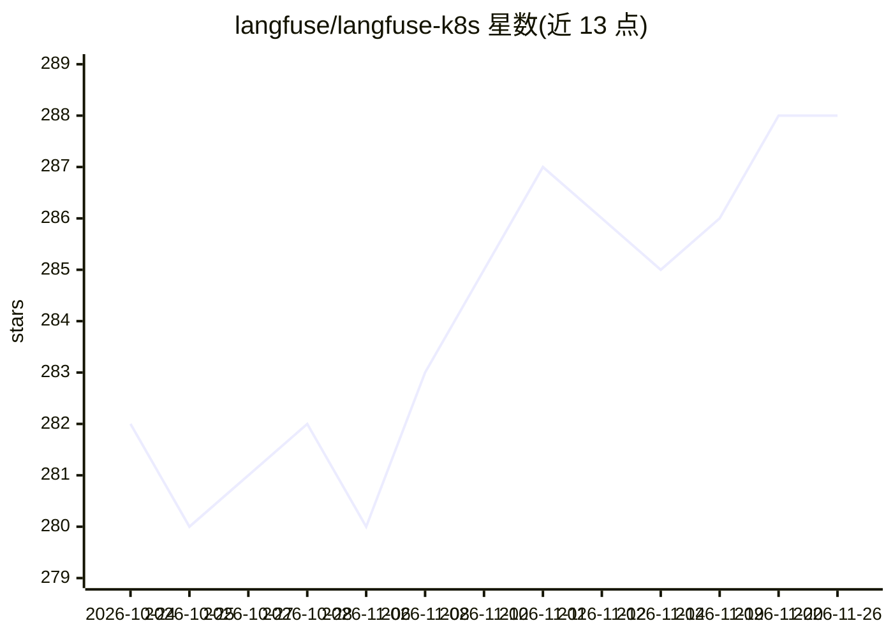

# langfuse/langfuse-k8s

⭐ 288 · Go Template · MIT · 推送 2026-11-25 · [GitHub](https://github.com/langfuse/langfuse-k8s) · [官网](https://langfuse.com/self-hosting/deployment/kubernetes-helm)

**在 Kubernetes 上部署 Langfuse 自托管环境的社区 Helm chart**

由社区维护、用于在 Kubernetes 上部署 Langfuse（LLM 工程平台）的 Helm chart 仓库，含 examples 示例配置与 charts/langfuse chart。v2.0.0 起以 OSS 许可子图表替换 Bitnami 子图表，捆绑 Postgres、ClickHouse（经 clickhouse-operator）、Valkey、SeaweedFS，并自动生成并持久化应用凭证；提供 v1→v2 迁移路径与空卷升级保护。要求 Helm ≥3.17、Kubernetes ≥1.28，需预装 cert-manager 与 ClickHouse CRD。另含应用内 AI 功能与 beta AI gateway 的部署配置。

## 筛选速览

| 维度 | 判定 | 备注 |
|---|---|---|
| AI 角色 | `ai-ecosystem` | LLM/agent 周边工具 |
| 许可风险 | `permissive` | MIT |
| 部署形态 | `library` | 以包/库形式分发 |
| 模型依赖 | — | README 未给出锁定关系 |
| 硬件要求 | — | 无带数字的原话,不猜 |
| 安装摩擦 | `low` | 无编译、无系统依赖或容器化 |
| 成熟度 | — | 结构信号不足 |

## 能力要点

- Helm chart 一键部署 Langfuse 及捆绑的 Postgres/ClickHouse/Valkey/SeaweedFS
- 首次安装自动生成凭证 Secrets 并跨升级持久化（lookup）
- v1→v2 迁移指南与空卷升级阻塞保护
- 可选部署 beta AI gateway（独立 Deployment/Service/Ingress/HPA）

## 适用场景

- 在 Kubernetes 集群自托管部署 Langfuse
- 通过 GitOps/ArgoCD 管理 Langfuse 部署（需显式固定凭证）
- 为自托管实例启用 AI gateway 与应用内 AI 功能

## 场景标签

`LLM 可观测性` · 领域:评测与运维

## 证据(README 行号)

> L7: This is a community-maintained repository that contains resources for deploying Langfuse on Kubernetes.
> L61: We provide a Helm chart that helps you deploy Langfuse on Kubernetes.

## 星数曲线

2026-10-24 282 → 2026-11-26 288（+6）

---
*卡片 v1 · prompt 1.4 · 生成 2026-11-26 · 置信度 high · 依据 README sha `6506240cb756` · [字段定义](../../DATASET.md)*
