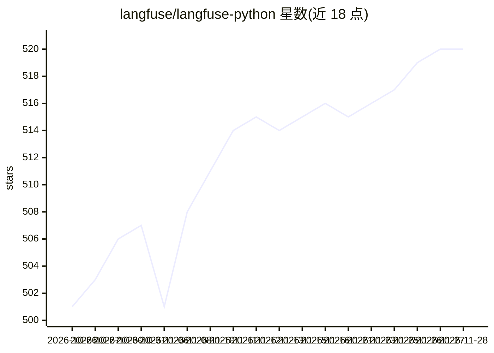

# langfuse/langfuse-python

⭐ 520 · Python · MIT · 推送 2026-11-27 · [GitHub](https://github.com/langfuse/langfuse-python) · [官网](https://langfuse.com/docs/observability/sdk/overview) · 组织维护

**为 Python 开发者提供 Langfuse 平台的 LLM 可观测 SDK**

Langfuse 官方 Python SDK（v5，基于 OpenTelemetry），覆盖 Langfuse 平台全部能力：基于 OpenTelemetry 的追踪观测（含 OpenAI 与 LangChain 集成）、数据集与实验（提示/模型变更的离线评估与回归测试，可经 GitHub Actions 接入 CI）、LLM-as-a-judge 及自定义评分、提示管理，以及完整 REST API 客户端。需 Python 3.11+，连接 Langfuse Cloud 或自托管 Langfuse 4.59.0+；legacy v2 客户端 API 已弃用，多数 GET API 数据可延迟达 10 分钟，实时路径仅限 OpenTelemetry 摄取。

## 筛选速览

| 维度 | 判定 | 备注 |
|---|---|---|
| AI 角色 | `ai-ecosystem` | LLM/agent 周边工具 |
| 许可风险 | `permissive` | MIT |
| 部署形态 | `library` | 以包/库形式分发 |
| 模型依赖 | — | README 未给出锁定关系 |
| 硬件要求 | — | 无带数字的原话,不猜 |
| 安装摩擦 | `low` | 无编译、无系统依赖或容器化 |
| 成熟度 | — | 结构信号不足 |

## 能力要点

- 基于 OpenTelemetry 的 LLM 追踪，提供 OpenAI 与 LangChain 集成
- 数据集与实验支持离线评估、回归测试并接入 GitHub Actions CI
- 内置 LLM-as-a-judge 与自定义评分、提示管理
- 提供完整 REST API 客户端与 Observations API v2 查询

## 适用场景

- 为调用 LLM 的 Python 应用接入追踪与可观测性
- 对提示与模型变更做离线评估和回归测试
- 集中管理提示词并对模型输出打分

## 场景标签

`LLM 可观测性` `模型评测` · 领域:评测与运维

## 证据(README 行号)

> L23: The Langfuse Python SDK covers the full platform: **observability/tracing** (OpenTelemetry-based, with OpenAI and L
> L17: > **Latest Python SDK (OpenTelemetry):** `pip install langfuse`. Use `get_client()` + `start_as_current_observation

## 星数曲线

2026-10-26 501 → 2026-11-28 520（+19）

---
*卡片 v1 · prompt 1.4 · 生成 2026-11-27 · 置信度 high · 依据 README sha `d993631348f1` · [字段定义](../../DATASET.md)*
