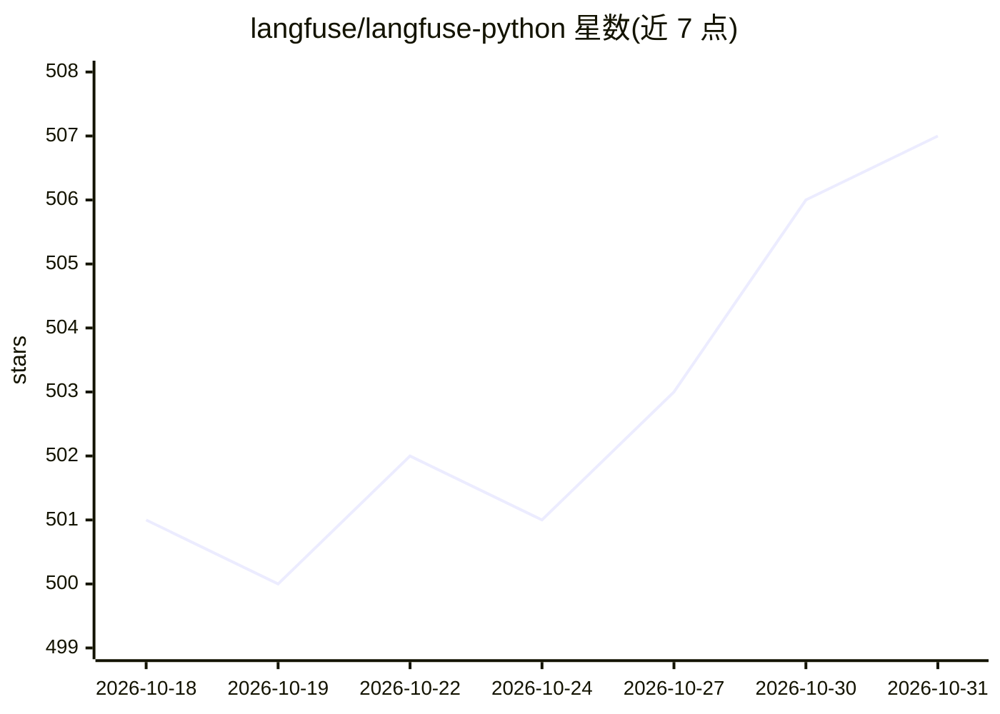

# langfuse/langfuse-python

⭐ 507 · Python · MIT · 推送 2026-10-30 · [GitHub](https://github.com/langfuse/langfuse-python) · [官网](https://langfuse.com/docs/observability/sdk/overview) · 组织维护

**Langfuse 平台的 Python SDK：LLM 应用追踪与评测接入**

Langfuse 官方 Python SDK，覆盖平台全部功能：基于 OpenTelemetry 的 observability/tracing（含 OpenAI 与 LangChain 集成）、数据集与实验（离线评测、prompt/模型变更回归测试、可经 GitHub Actions 接入 CI）、LLM-as-a-judge 与自定义评分、prompt 管理及完整 REST API 客户端。v4 版本重写，旧 v2 客户端 API 已弃用；实时路径需 OpenTelemetry 摄取配合 Observations/Metrics API v2。面向构建 LLM 应用的开发者。

## 筛选速览

| 维度 | 判定 | 备注 |
|---|---|---|
| AI 角色 | `ai-ecosystem` | LLM/agent 周边工具 |
| 许可风险 | `permissive` | MIT |
| 部署形态 | `library` | 以包/库形式分发 |
| 模型依赖 | — | README 未给出锁定关系 |
| 硬件要求 | — | 无带数字的原话,不猜 |
| 安装摩擦 | `low` | 无编译、无系统依赖或容器化 |
| 成熟度 | — | 结构信号不足 |

## 能力要点

- 基于 OpenTelemetry 的追踪，提供 OpenAI 与 LangChain 集成
- 数据集与实验：离线评测与回归测试，支持 GitHub Actions CI
- LLM-as-a-judge 与自定义评分、prompt 管理
- 含完整 REST API 客户端

## 适用场景

- 为 LLM 应用接入 Langfuse 的追踪与观测
- 对 prompt 或模型变更做离线评测与回归测试
- 在 CI 流程中自动运行 LLM 实验评测

## 场景标签

`LLM 可观测性` `模型评测` · 领域:评测与运维

## 证据(README 行号)

> L23: The Langfuse Python SDK covers the full platform: **observability/tracing** (OpenTelemetry-based, with OpenAI and L
> L17: > **Latest Python SDK (OpenTelemetry):** `pip install langfuse`. Use `get_client()` + `start_as_current_observation

## 星数曲线

2026-10-18 501 → 2026-10-31 507（+6）

---
*卡片 v1 · prompt 1.4 · 生成 2026-10-21 · 置信度 high · 依据 README sha `175ac33a291b` · [字段定义](../../DATASET.md)*
